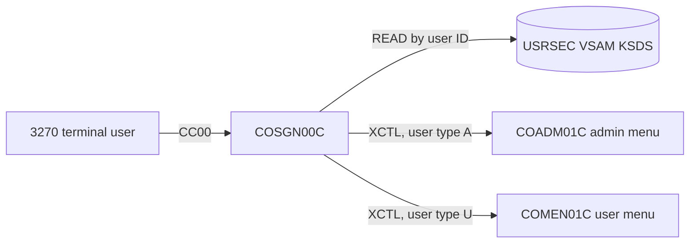
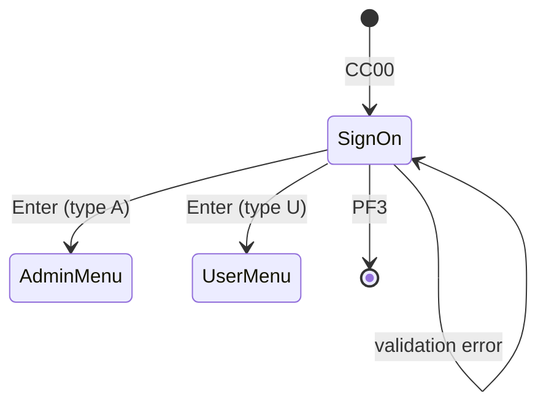

# Tesco Online Transaction System Documentation

> **Template:** copy this file per online transaction (or transaction group) and replace every `<placeholder>`.
> The example rows use the CardDemo sign-on transaction (`CC00` / `COSGN00C`, reading the `USRSEC` file through copybook `CSUSR01Y`) to show the expected level of detail. Delete or replace them in your copy.

---

## 1. Document Control

| Field | Value |
|---|---|
| Document title | `<System / transaction name>` Online Transaction Documentation |
| Document ID | `<TES-APP-XXXX-OTD-001>` |
| Version | `<0.1>` |
| Status | `<Draft / In Review / Approved / Superseded>` |
| Classification | **Tesco Internal** |
| Owning team | `<Team / Tribe>` |
| Application / service ID | `<CMDB CI or ServiceNow application ID>` |
| Author | `<Name, role>` |
| Reviewer(s) | `<Name, role>` |
| Approver | `<Name, role>` |
| Date created | `<YYYY-MM-DD>` |
| Last updated | `<YYYY-MM-DD>` |
| Next review due | `<YYYY-MM-DD>` |

### 1.1 Distribution

| Audience | Purpose |
|---|---|
| `<Application support / L2>` | `<Operational reference>` |
| `<Development team>` | `<Maintenance and change>` |
| `<Information Security / Compliance>` | `<PCI-DSS and GDPR review>` |

> **Classification notice:** This document is classified **Tesco Internal**. Do not share it outside Tesco or with third parties without a signed NDA and approval from the document owner.

---

## 2. Purpose

`<One or two paragraphs: what business function this online transaction provides, who uses it, and why this document exists (support, change, audit, modernisation).>`

*Example:* Transaction `CC00` is the CardDemo sign-on screen. It authenticates a user against the user security file and routes them to the admin menu or the regular user menu, depending on the user type.

---

## 3. Scope

### 3.1 In scope

- `<Transactions / programs / screens covered>`
- `<Files, databases and queues read or written>`
- `<Interfaces to other systems>`

### 3.2 Out of scope

- `<Related batch jobs documented elsewhere (link)>`
- `<Downstream systems owned by other teams>`

### 3.3 Assumptions and constraints

- `<e.g. Runs in CICS region CICSPRD1 only; no MRO routing>`

---

## 4. Architecture Overview

### 4.1 Context

`<Describe where the transaction sits: terminal / web front end -> CICS region -> programs -> data stores -> downstream systems.>`

### 4.2 Runtime environment

| Item | Value |
|---|---|
| Platform | `<z/OS version / LPAR>` |
| Transaction manager | `<CICS TS version, region APPLID>` |
| Language(s) | `<Enterprise COBOL version>` |
| Data stores | `<VSAM / DB2 / IMS / MQ>` |
| CSD group | `<CARDDEMO>` |

---

## 5. Transaction / Program Inventory

| Transaction ID | Program | Mapset / Map | Description | Entry point? | Owner |
|---|---|---|---|---|---|
| `CC00` | `COSGN00C` | `COSGN00` / `COSGN0A` | Sign-on: validates user ID and password against `USRSEC` | Yes | `<Team>` |
| `<TRAN>` | `<PROGRAM>` | `<MAPSET>` / `<MAP>` | `<Description>` | `<Yes/No>` | `<Team>` |

### 5.1 Copybooks used

| Copybook | Purpose | Used by |
|---|---|---|
| `CSUSR01Y` | User security record layout (`SEC-USER-DATA`) | `COSGN00C` |
| `COCOM01Y` | Common COMMAREA (`CARDDEMO-COMMAREA`) passed between programs | `COSGN00C` and menus |
| `CSMSG01Y` | Common messages (thank-you, invalid key) | `COSGN00C` |
| `<COPYBOOK>` | `<Purpose>` | `<Programs>` |

---

## 6. Screen / Interface Definition

### 6.1 Screen layout

`<Screenshot or ASCII capture of the 24x80 screen.>`

### 6.2 Field definitions

| Field name | Row, col | Length | Attributes | Input / output | Validation | Description |
|---|---|---|---|---|---|---|
| `USERID` | `<r,c>` | 8 | `UNPROT, IC, FSET` | Input | Required; changed to upper case | User ID |
| `PASSWD` | `<r,c>` | 8 | `UNPROT, DRK, FSET` (not displayed) | Input | Required; changed to upper case | Password |
| `ERRMSG` | 23,1 | 78 | `ASKIP, BRT`, red | Output | n/a | Error or information message |
| `<FIELD>` | `<r,c>` | `<n>` | `<attrs>` | `<I/O>` | `<rule>` | `<description>` |

### 6.3 Function keys

| Key | Action |
|---|---|
| Enter | Validate credentials and sign on |
| PF3 | Exit, showing `Thank you for using CardDemo application...` |
| Any other key | Stay on the screen, showing `Invalid key pressed. Please see below...` |

### 6.4 Messages

| Condition | Message text (exact) |
|---|---|
| User ID blank | `Please enter User ID ...` |
| Password blank | `Please enter Password ...` |
| User not on file (RESP 13 / NOTFND) | `User not found. Try again ...` |
| Password mismatch | `Wrong Password. Try again ...` |
| Any other file error | `Unable to verify the User ...` |

### 6.5 Non-screen interfaces (if any)

| Interface | Type | Direction | Format | Counterparty |
|---|---|---|---|---|
| `<e.g. MQ queue / web service / LINK>` | `<MQ / HTTP / CICS LINK>` | `<In / Out>` | `<copybook / JSON schema>` | `<System>` |

---

## 7. Data and File Dependencies

### 7.1 Files / tables

| CICS file / table | Dataset / object | Type | Key | Record length | Access | Copybook |
|---|---|---|---|---|---|---|
| `USRSEC` | `AWS.M2.CARDDEMO.USRSEC.VSAM.KSDS` | VSAM KSDS | `SEC-USR-ID` (8 bytes, offset 0) | 80 | Read | `CSUSR01Y` |
| `<FILE>` | `<DSN>` | `<KSDS / ESDS / DB2>` | `<key>` | `<len>` | `<R / W / U / D / Browse>` | `<COPYBOOK>` |

### 7.2 Record layout

| Field | PIC | Offset | Length | Description | Sensitive? |
|---|---|---|---|---|---|
| `SEC-USR-ID` | `X(08)` | 0 | 8 | User ID (key) | Personal data |
| `SEC-USR-FNAME` | `X(20)` | 8 | 20 | First name | Personal data |
| `SEC-USR-LNAME` | `X(20)` | 28 | 20 | Last name | Personal data |
| `SEC-USR-PWD` | `X(08)` | 48 | 8 | Password | **Credential** |
| `SEC-USR-TYPE` | `X(01)` | 56 | 1 | `A` = admin, `U` = user | No |
| `SEC-USR-FILLER` | `X(23)` | 57 | 23 | Reserved | No |

### 7.3 COMMAREA / channel data

| Field | Set by | Used by | Description |
|---|---|---|---|
| `CDEMO-USER-ID` | `COSGN00C` | All menus | Signed-on user |
| `CDEMO-USER-TYPE` | `COSGN00C` | All menus | `A` / `U` from `SEC-USR-TYPE` |
| `CDEMO-FROM-TRANID` / `CDEMO-FROM-PROGRAM` | Caller | Callee | Return navigation |
| `<FIELD>` | `<program>` | `<program>` | `<description>` |

---

## 8. Processing Logic

### 8.1 Main flow

`<Numbered steps or pseudocode for each path, with paragraph names.>`

*Example (`COSGN00C`):*

1. **First entry** (`EIBCALEN = 0`): clear the map, put the cursor on `USERID`, send the sign-on screen.
2. **Enter** (`PROCESS-ENTER-KEY`): receive `COSGN0A`. If `USERID` or `PASSWD` is blank, show the error and send the screen again.
3. Change the user ID and password to upper case, then `READ-USER-SEC-FILE`: `EXEC CICS READ DATASET('USRSEC') RIDFLD(user ID)`.
4. **RESP 0 and password matches:** fill in the COMMAREA (`CDEMO-USER-ID`, `CDEMO-USER-TYPE`, from-tranid/program), then `XCTL` to `COADM01C` if the type is admin, otherwise to `COMEN01C`.
5. **RESP 0 and password differs, RESP 13, or other RESP:** show the matching message from section 6.4 and send the screen again.
6. **PF3:** send the thank-you text and end. **Any other key:** show the invalid-key message.
7. Pseudo-conversational return: `EXEC CICS RETURN TRANSID('CC00') COMMAREA(CARDDEMO-COMMAREA)`.

### 8.2 Business rules

| Rule ID | Rule | Source (program / paragraph) |
|---|---|---|
| BR-01 | User ID and password are compared in upper case | `COSGN00C` / `PROCESS-ENTER-KEY` |
| BR-02 | User type `A` goes to the admin menu, anything else to the user menu | `COSGN00C` / `READ-USER-SEC-FILE` |
| `<BR-nn>` | `<Rule>` | `<Program / paragraph>` |

### 8.3 Error handling and abends

| Condition | Handling | Abend code | Support action |
|---|---|---|---|
| `USRSEC` closed or disabled | Message `Unable to verify the User ...` | None | `<Check file status in CEMT, open file>` |
| `<condition>` | `<handling>` | `<code>` | `<action>` |

---

## 9. Navigation Flow

| From | Action / key | To | Transfer method |
|---|---|---|---|
| Terminal (blank screen) | Type `CC00` | `COSGN00C` | Transaction start |
| `COSGN00C` | Enter, admin user | `COADM01C` (admin menu) | `XCTL` + COMMAREA |
| `COSGN00C` | Enter, regular user | `COMEN01C` (user menu) | `XCTL` + COMMAREA |
| `COSGN00C` | PF3 | End of session | `SEND TEXT`, then `RETURN` |
| `<FROM>` | `<key>` | `<TO>` | `<XCTL / LINK / RETURN TRANSID / START>` |

---

## 10. Security & Compliance

### 10.1 Access control

| Item | Value |
|---|---|
| Transaction security (RACF / ACF2 / Top Secret profile) | `<TCICSTRN.CC00 or equivalent>` |
| Resource security (`RESSEC`) | `<YES / NO>` (CardDemo CSD: `NO`) |
| Command security (`CMDSEC`) | `<YES / NO>` (CardDemo CSD: `NO`) |
| Application-level authentication | `<e.g. USRSEC user ID / password check in COSGN00C>` |
| Privileged roles | `<e.g. SEC-USR-TYPE = 'A'>` |

### 10.2 PCI-DSS

| Requirement area | Applies? | How it is met / gap | Evidence |
|---|---|---|---|
| Req 3: protect stored account data (PAN, CVV) | `<Y/N>` | `<Masking, encryption, truncation>` | `<link>` |
| Req 4: encrypt cardholder data in transit | `<Y/N>` | `<TN3270 over TLS, AT-TLS>` | `<link>` |
| Req 7: restrict access by business need to know | `<Y/N>` | `<RACF groups, user type>` | `<link>` |
| Req 8: identify and authenticate users | `<Y/N>` | `<Password policy, MFA>`; *CardDemo example: 8-char password stored in clear text in `SEC-USR-PWD`, which is a gap* | `<link>` |
| Req 10: log and monitor all access | `<Y/N>` | `<SMF 110, CICS journals, SIEM feed>` | `<link>` |

### 10.3 GDPR / UK GDPR

| Item | Value |
|---|---|
| Personal data processed | `<e.g. user first/last name (SEC-USR-FNAME, SEC-USR-LNAME), customer name, address>` |
| Lawful basis | `<Contract / Legal obligation / Legitimate interest>` |
| Data subjects | `<Colleagues / Customers>` |
| Retention period | `<n years; reference to retention schedule>` |
| Data subject rights handling | `<How access / erasure requests reach this data>` |
| DPIA reference | `<ID or N/A>` |
| Transfers outside UK/EEA | `<None / details>` |

### 10.4 Sensitive data handling

- `<Fields never written to logs, dumps or trace (e.g. SEC-USR-PWD, PAN)>`
- `<Masking rules on screens and reports>`

---

## 11. Operational Information

### 11.1 CICS resource definitions

| Resource type | Name | Group | Key attributes |
|---|---|---|---|
| TRANSACTION | `CC00` | `CARDDEMO` | `PROGRAM(COSGN00C) PROFILE(DFHCICST) TRANCLASS(DFHTCL00) PRIORITY(1)` |
| PROGRAM | `COSGN00C` | `CARDDEMO` | `TRANSID(CC00) CONCURRENCY(QUASIRENT) EXECKEY(USER)` |
| MAPSET | `COSGN00` | `CARDDEMO` | `RESIDENT(NO) USAGE(NORMAL)` |
| FILE | `USRSEC` | `CARDDEMO` | `DSNAME(AWS.M2.CARDDEMO.USRSEC.VSAM.KSDS) STRINGS(1) OPENTIME(FIRSTREF) READ(YES)` |
| `<TYPE>` | `<NAME>` | `<GROUP>` | `<attributes>` |

### 11.2 Batch dependencies

| Job | When | Relationship to online | Impact if it fails |
|---|---|---|---|
| `DUSRSECJ` | `<On demand / initial load>` | Defines and loads `USRSEC` | Sign-on fails with `Unable to verify the User ...` |
| `<JOB>` | `<schedule>` | `<Closes/opens files, refreshes data>` | `<impact>` |

### 11.3 Online availability window and SLAs

| Item | Target |
|---|---|
| Service hours | `<e.g. 24x7 except Sunday 02:00 to 04:00 maintenance>` |
| Availability | `<e.g. 99.9% monthly>` |
| Response time | `<e.g. 95% of transactions in under 1 second>` |
| Peak volume | `<e.g. n transactions per minute>` |
| Recovery time objective (RTO) | `<e.g. 30 minutes>` |
| Recovery point objective (RPO) | `<e.g. 0, VSAM forward recovery>` |
| Incident priority mapping | `<P1 / P2 criteria>` |

### 11.4 Monitoring and support

| Item | Value |
|---|---|
| Monitoring tool | `<OMEGAMON / CICS PA / Datadog>` |
| Alerts | `<e.g. CC00 abend count > 5 in 5 minutes>` |
| Support group | `<ServiceNow assignment group>` |
| Runbook | `<link>` |
| Escalation | `<On-call rota / PagerDuty service>` |

---

## 12. Testing

### 12.1 Test environments

| Environment | CICS region | Data |
|---|---|---|
| `<DEV>` | `<APPLID>` | `<Synthetic>` |
| `<UAT>` | `<APPLID>` | `<Masked copy of production>` |

### 12.2 Test cases

| ID | Scenario | Input | Expected result | Status |
|---|---|---|---|---|
| TC-01 | Valid admin sign-on | Admin user ID and correct password | `XCTL` to `COADM01C` | `<Pass/Fail>` |
| TC-02 | Valid regular user sign-on | User ID and correct password | `XCTL` to `COMEN01C` | `<Pass/Fail>` |
| TC-03 | Blank user ID | Enter with `USERID` empty | `Please enter User ID ...` | `<Pass/Fail>` |
| TC-04 | Wrong password | Valid user ID, wrong password | `Wrong Password. Try again ...` | `<Pass/Fail>` |
| TC-05 | Unknown user | User ID not on `USRSEC` | `User not found. Try again ...` | `<Pass/Fail>` |
| TC-06 | Lower-case input | Lower-case user ID and password | Accepted (changed to upper case) | `<Pass/Fail>` |
| TC-07 | PF3 | PF3 | Thank-you message, session ends | `<Pass/Fail>` |
| `<TC-nn>` | `<scenario>` | `<input>` | `<expected>` | `<status>` |

### 12.3 Regression and non-functional testing

- `<Performance / load test approach>`
- `<Security test (penetration test, access review)>`

---

## 13. Change History

| Version | Date | Author | Change reference (CR / Jira) | Summary |
|---|---|---|---|---|
| 0.1 | `<YYYY-MM-DD>` | `<Name>` | `<CHG0000000>` | Initial draft |
| `<x.y>` | `<YYYY-MM-DD>` | `<Name>` | `<ref>` | `
` |

---

## 14. Appendix

### 14.1 Glossary

| Term | Meaning |
|---|---|
| BMS | Basic Mapping Support: CICS screen definitions (mapsets/maps) |
| COMMAREA | Communication area passed between CICS programs |
| CSD | CICS System Definition file holding resource definitions |
| KSDS | VSAM Key-Sequenced Data Set |
| XCTL | CICS transfer of control to another program without return |
| PAN | Primary Account Number (card number) |

### 14.2 References

| Document | Location |
|---|---|
| Source: program | `app/cbl/COSGN00C.cbl` |
| Source: mapset | `app/bms/COSGN00.bms` |
| Source: copybook | `app/cpy/CSUSR01Y.cpy` |
| CSD definitions | `app/csd/CARDDEMO.CSD` |
| File definition JCL | `app/jcl/DUSRSECJ.jcl` |
| `<Related design / runbook>` | `<link>` |

### 14.3 Open issues

| ID | Issue | Owner | Target date |
|---|---|---|---|
| `<OI-01>` | `<description>` | `<name>` | `<YYYY-MM-DD>` |

---

*Classification: Tesco Internal*
