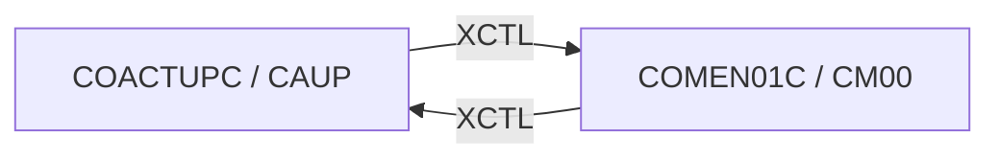

# Tesco | CICS Transaction: `CAUP` (Account Update)

> **Tesco | Mainframe Application Documentation**
> Application: **CardDemo** &nbsp;|&nbsp; Module: **Base application** &nbsp;|&nbsp; Classification: **Tesco Internal**
> Document owner: TODO: owning team &nbsp;|&nbsp; Last reviewed: 2026-11-13

Generated from [`docs/templates/TRANSACTION_DOC_TEMPLATE.md`](../templates/TRANSACTION_DOC_TEMPLATE.md). Back to the [transaction index](README.md).

---

## 1. Transaction ID

| Attribute | Value |
|:--|:--|
| Transaction ID | `CAUP` |
| CSD group | `CARDDEMO` |
| CSD definition | `app/csd/CARDDEMO.CSD` |
| CSD description | CREDIT CARD DEMO ACCOUNT UPDATE |
| Profile / Tran class | `DFHCICST` / `DFHTCL00` |
| Other CSD attributes | `TASKDATALOC(ANY)`, `TASKDATAKEY(USER)`, `ISOLATE(YES)`, `RESSEC(NO)`, `CMDSEC(NO)` |
| README function | Account Update |

## 2. Program name

| Attribute | Value |
|:--|:--|
| Initial program | `COACTUPC` |
| Source | [`app/cbl/COACTUPC.cbl`](../../app/cbl/COACTUPC.cbl) |
| Program type | CICS COBOL |
| Program header "Function" | Accept and process ACCOUNT UPDATE |

## 3. Mapset / BMS map

| Attribute | Value |
|:--|:--|
| Mapset | `COACTUP` ([`app/bms/COACTUP.bms`](../../app/bms/COACTUP.bms)) |
| Map | `CACTUPA` |
| Symbolic map copybook | [`app/cpy-bms/COACTUP.CPY`](../../app/cpy-bms/COACTUP.CPY) |

## 4. Purpose / Description

Update account and customer details. After the account number is entered, the current account and customer records are shown; the user edits them, the program validates every field, asks for confirmation and then rewrites both `ACCTDAT` and `CUSTDAT` under `READ UPDATE` locks, checking that the record was not changed by someone else in between.

## 5. Invocation

| Path | Detail |
|:--|:--|
| Menu path | `CC00` → `CM00` option 2 "Account Update". |
| Direct tranid | With no COMMAREA the program starts a fresh COMMAREA and shows its screen. TODO: confirm the user/role context is set correctly when entered directly instead of through the menu. |
| Pseudo-conversational re-entry | `EXEC CICS RETURN TRANSID(CAUP) COMMAREA(...)` |

## 6. Inputs

### 6.1 COMMAREA

Shared CardDemo COMMAREA `CARDDEMO-COMMAREA` ([`app/cpy/COCOM01Y.cpy`](../../app/cpy/COCOM01Y.cpy)). Fields referenced by this program:

| Field | Picture | Usage |
|:--|:--|:--|
| `CDEMO-ACCT-ID` | `9(11)` | Account in context |
| `CDEMO-ACCT-STATUS` | `X(01)` | Account status |
| `CDEMO-CARD-NUM` | `9(16)` | Card in context |
| `CDEMO-CUST-FNAME` | `X(25)` | Customer first name |
| `CDEMO-CUST-ID` | `9(09)` | Customer in context |
| `CDEMO-CUST-LNAME` | `X(25)` | Customer last name |
| `CDEMO-CUST-MNAME` | `X(25)` | Customer middle name |
| `CDEMO-FROM-PROGRAM` | `X(08)` | Program of the calling screen (PF3 target) |
| `CDEMO-FROM-TRANID` | `X(04)` | Tranid of the calling screen |
| `CDEMO-LAST-MAP` | `X(7)` | Last map sent |
| `CDEMO-LAST-MAPSET` | `X(7)` | Last mapset sent |
| `CDEMO-TO-PROGRAM` | `X(08)` | Program to XCTL to |
| `CDEMO-TO-TRANID` | `X(04)` | Tranid to transfer to |

The program appends its own working fields after the shared area (paging keys, selection flags). See the program source for the layout.

### 6.2 Screen fields (unprotected)

| BMS field | Length | Label (same screen row) |
|:--|:--|:--|
| `ACCTSID` | 11 | Account Number |
| `ACSTTUS` | 1 | Active Y/N |
| `OPNYEAR` | 4 | Opened |
| `OPNMON` | 2 |  |
| `OPNDAY` | 2 |  |
| `ACRDLIM` | 15 | Credit Limit |
| `EXPYEAR` | 4 | Expiry |
| `EXPMON` | 2 |  |
| `EXPDAY` | 2 |  |
| `ACSHLIM` | 15 | Cash credit Limit |
| `RISYEAR` | 4 | Reissue |
| `RISMON` | 2 |  |
| `RISDAY` | 2 |  |
| `ACURBAL` | 15 | Current Balance |
| `ACRCYCR` | 15 | Current Cycle Credit |
| `AADDGRP` | 10 | Account Group |
| `ACRCYDB` | 15 | Current Cycle Debit |
| `ACSTNUM` | 9 | Customer id |
| `ACTSSN1` | 3 | SSN |
| `ACTSSN2` | 2 |  |
| `ACTSSN3` | 4 |  |
| `DOBYEAR` | 4 | Date of birth |
| `DOBMON` | 2 |  |
| `DOBDAY` | 2 |  |
| `ACSTFCO` | 3 | FICO Score |
| `ACSFNAM` | 25 |  |
| `ACSMNAM` | 25 |  |
| `ACSLNAM` | 25 |  |
| `ACSADL1` | 50 | Address |
| `ACSSTTE` | 2 | State |
| `ACSADL2` | 50 |  |
| `ACSZIPC` | 5 | Zip |
| `ACSCITY` | 50 | City |
| `ACSCTRY` | 3 | Country |
| `ACSPH1A` | 3 | Phone 1 |
| `ACSPH1B` | 3 |  |
| `ACSPH1C` | 4 |  |
| `ACSGOVT` | 20 | Government Issued Id Ref |
| `ACSPH2A` | 3 | Phone 2 |
| `ACSPH2B` | 3 |  |
| `ACSPH2C` | 4 |  |
| `ACSEFTC` | 10 | EFT Account Id |
| `ACSPFLG` | 1 | Primary Card Holder Y/N |

### 6.3 Function keys

| Key | Action |
|:--|:--|
| ENTER | Fetch account / validate changed fields |
| PF5 | Confirm and save changes |
| PF12 | Cancel changes and re-show original values |
| PF3 | Exit to the calling program / Main Menu |

## 7. Outputs

- **Screen:** `INFOMSG`, `ERRMSG`, `FKEYS`, `FKEY05`, `FKEY12` (plus the standard header: `TITLE01`, `TITLE02`, `TRNNAME`, `PGMNAME`, `CURDATE`, `CURTIME`).
- **Messages** (literals found in the program):
  - "Details of selected account shown above"
  - "Enter or update id of account to update"
  - "Update account details presented above."
  - "Changes validated.Press F5 to save"
  - "Changes committed to database"
  - "Changes unsuccessful. Please try again"
  - "PF03 pressed.Exiting"
  - "Account number not provided"
  - "Last name not provided"
  - "Name can only contain alphabets and spaces"
  - ... 19 more in the source.
- **Records written / messages sent:** `ACCTDAT` (REWRITE), `CUSTDAT` (REWRITE)

## 8. Data stores accessed

| Type | Resource | Physical name / definition | Record layout | Access |
|:--|:--|:--|:--|:--|
| VSAM | `ACCTDAT` | `AWS.M2.CARDDEMO.ACCTDATA.VSAM.KSDS` | `CVACT01Y` (key: Account ID) | `READ`, `READ UPDATE`, `REWRITE` |
| VSAM | `CUSTDAT` | `AWS.M2.CARDDEMO.CUSTDATA.VSAM.KSDS` | `CVCUS01Y` (key: Customer ID) | `READ`, `READ UPDATE`, `REWRITE` |
| VSAM | `CXACAIX` | `AWS.M2.CARDDEMO.CARDXREF.VSAM.AIX.PATH` | `CVACT03Y` (key: Account ID (alternate index path over CCXREF)) | `READ` |

No DB2, IMS, MQ access found in `COACTUPC`.

## 9. Called / linked programs (XCTL / LINK flow)

| Direction | Mechanism | Program (Tranid) | Condition |
|:--|:--|:--|:--|
| Outbound | XCTL | [`COMEN01C`](CM00.md) (`CM00`) | PF3 (exit): back to the Main Menu (or to `CDEMO-FROM-PROGRAM` when it was set by the caller) |
| Inbound | XCTL | [`COMEN01C`](CM00.md) (`CM00`) | Menu selection |

## 10. Error handling

| Condition | Detection | Behaviour / message |
|:--|:--|:--|
| NOTFND | `DFHRESP(NOTFND)` | Record not found: message shown, key field highlighted |
| Any other CICS response | `RESP` / `RESP2` not handled above | Generic "unable to ..." message with the response code |
| Unexpected abend | `EXEC CICS HANDLE ABEND LABEL(ABEND-ROUTINE)` | Abend details sent to the terminal; then `EXEC CICS ABEND ABCODE(9999)` |
| Invalid key pressed | AID not in the list in 6.3 | Invalid-key message, screen re-sent |

## 11. Security / authorization

| Control | Detail |
|:--|:--|
| Sign-on | User must have signed on through `CC00` (`USRSEC`); identity travels in `CDEMO-USER-ID` / `CDEMO-USER-TYPE`. |
| Role / function | Updates customer PII and credit limits. Any signed-on user reaching `CM00` can use it (menu option flagged `U`). |
| CICS resource security | CSD `RESSEC(NO)`, `CMDSEC(NO)`: no CICS resource or command checks. |
| External security (RACF / ACF2 / Top Secret) | TODO: transaction profile for `CAUP` (TCICSTRN / GCICSTRN) owned by the Tesco security team. |

## 12. Change history

| Date | Version / commit | Author | Change |
|:--|:--|:--|:--|
| 2026-11-13 | - | Devin | Initial document generated from template and source inspection. |
| 2025-08-03 | `fb78417` | Arunkumar Selvam | Last repository change to `COACTUPC.cbl`: Add optional modules and enhanced functionality |
| - | CSD | AWSUSER | CSD `DEFINETIME(22/06/10 20:05:10)`, `CHANGETIME(22/06/10 20:29:43)` |

## Open items (TODO)

- [ ] TODO: Confirm business rules for credit-limit changes (who may raise a limit) with the business owner.
- [ ] TODO: confirm external security (RACF) definitions for `CAUP`.
- [ ] TODO: assign a document owner.

---
*Tesco | Internal use only. Generated from `docs/templates/TRANSACTION_DOC_TEMPLATE.md`.*
