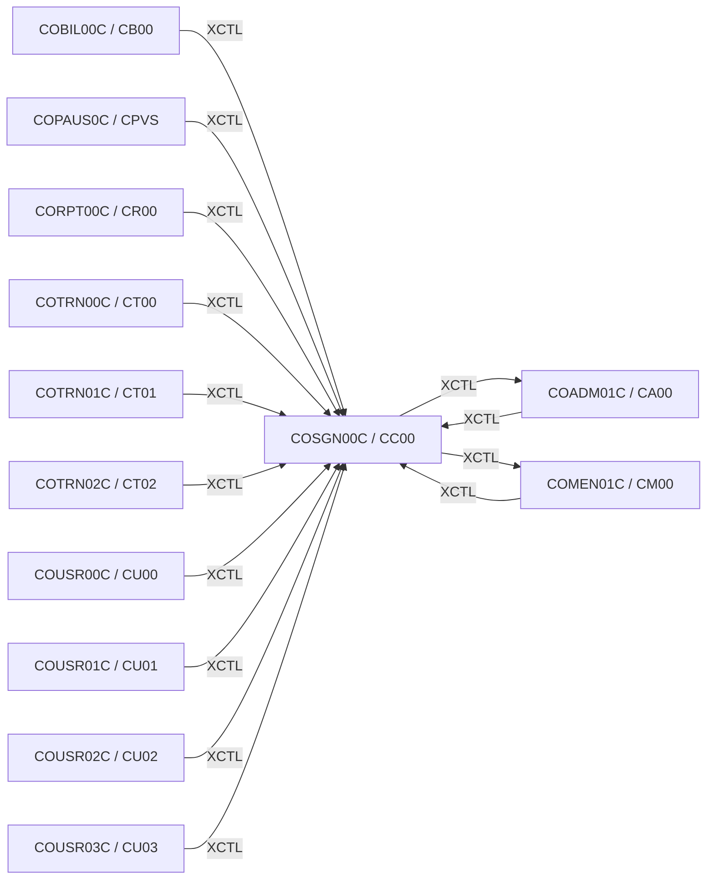

# Tesco | CICS Transaction: `CC00` (Sign-on)

> **Tesco | Mainframe Application Documentation**
> Application: **CardDemo** &nbsp;|&nbsp; Module: **Base application** &nbsp;|&nbsp; Classification: **Tesco Internal**
> Document owner: TODO: owning team &nbsp;|&nbsp; Last reviewed: 2026-11-13

Generated from [`docs/templates/TRANSACTION_DOC_TEMPLATE.md`](../templates/TRANSACTION_DOC_TEMPLATE.md). Back to the [transaction index](README.md).

---

## 1. Transaction ID

| Attribute | Value |
|:--|:--|
| Transaction ID | `CC00` |
| CSD group | `CARDDEMO` |
| CSD definition | `app/csd/CARDDEMO.CSD` |
| CSD description | (none in CSD) |
| Profile / Tran class | `DFHCICST` / `DFHTCL00` |
| Other CSD attributes | `TASKDATALOC(ANY)`, `TASKDATAKEY(USER)`, `ISOLATE(YES)`, `RESSEC(NO)`, `CMDSEC(NO)` |
| README function | Signon Screen |

## 2. Program name

| Attribute | Value |
|:--|:--|
| Initial program | `COSGN00C` |
| Source | [`app/cbl/COSGN00C.cbl`](../../app/cbl/COSGN00C.cbl) |
| Program type | CICS COBOL |
| Program header "Function" | Signon Screen for the CardDemo Application |

## 3. Mapset / BMS map

| Attribute | Value |
|:--|:--|
| Mapset | `COSGN00` ([`app/bms/COSGN00.bms`](../../app/bms/COSGN00.bms)) |
| Map | `COSGN0A` |
| Symbolic map copybook | [`app/cpy-bms/COSGN00.CPY`](../../app/cpy-bms/COSGN00.CPY) |

## 4. Purpose / Description

Entry point to CardDemo. Shows the sign-on screen, reads the user ID and password, checks them against the `USRSEC` user security file and sends the user to the Admin Menu (`CA00`) or the Main Menu (`CM00`), depending on the user type stored on the record.

## 5. Invocation

| Path | Detail |
|:--|:--|
| Menu path | First screen of the application. Every other screen returns here on sign-off (PF3 from `CM00` / `CA00`). |
| Direct tranid | Yes. Type `CC00` on a clear CICS screen. With no COMMAREA the sign-on map is sent fresh. |
| Pseudo-conversational re-entry | `EXEC CICS RETURN TRANSID(CC00) COMMAREA(...)` |

## 6. Inputs

### 6.1 COMMAREA

Shared CardDemo COMMAREA `CARDDEMO-COMMAREA` ([`app/cpy/COCOM01Y.cpy`](../../app/cpy/COCOM01Y.cpy)). Fields referenced by this program:

| Field | Picture | Usage |
|:--|:--|:--|
| `CDEMO-FROM-PROGRAM` | `X(08)` | Program of the calling screen (PF3 target) |
| `CDEMO-FROM-TRANID` | `X(04)` | Tranid of the calling screen |
| `CDEMO-PGM-CONTEXT` | `9(01)` | `0` first entry / `1` re-entry |
| `CDEMO-USER-ID` | `X(08)` | Signed-on user ID |
| `CDEMO-USER-TYPE` | `X(01)` | `A` admin / `U` user |

### 6.2 Screen fields (unprotected)

| BMS field | Length | Label (same screen row) |
|:--|:--|:--|
| `USERID` | 8 | User ID |
| `PASSWD` | 8 | Password |

### 6.3 Function keys

| Key | Action |
|:--|:--|
| ENTER | Validate user ID / password and sign on |
| PF3 | Send a "thank you" plain-text message and end the session |

## 7. Outputs

- **Screen:** `APPLID`, `SYSID`, `ERRMSG` (plus the standard header: `TITLE01`, `TITLE02`, `TRNNAME`, `PGMNAME`, `CURDATE`, `CURTIME`).
- **Messages** (literals found in the program):
  - "Please enter User ID ..."
  - "Please enter Password ..."
  - "Wrong Password. Try again ..."
  - "User not found. Try again ..."
  - "Unable to verify the User ..."
- **Records written / messages sent:** None (read-only).

## 8. Data stores accessed

| Type | Resource | Physical name / definition | Record layout | Access |
|:--|:--|:--|:--|:--|
| VSAM | `USRSEC` | `AWS.M2.CARDDEMO.USRSEC.VSAM.KSDS` | `CSUSR01Y` (key: User ID) | `READ` |

No DB2, IMS, MQ access found in `COSGN00C`.

## 9. Called / linked programs (XCTL / LINK flow)

| Direction | Mechanism | Program (Tranid) | Condition |
|:--|:--|:--|:--|
| Outbound | XCTL | [`COADM01C`](CA00.md) (`CA00`) | Sign-on OK and `SEC-USR-TYPE` = `A` (admin) |
| Outbound | XCTL | [`COMEN01C`](CM00.md) (`CM00`) | Sign-on OK and user type = `U` (regular user) |
| Inbound | XCTL | [`COADM01C`](CA00.md) (`CA00`) | PF3: sign off |
| Inbound | XCTL | [`COBIL00C`](CB00.md) (`CB00`) | No COMMAREA (EIBCALEN = 0): back to sign-on |
| Inbound | XCTL | [`COMEN01C`](CM00.md) (`CM00`) | PF3: sign off |
| Inbound | XCTL | [`COPAUS0C`](CPVS.md) (`CPVS`) | No COMMAREA (EIBCALEN = 0): back to sign-on |
| Inbound | XCTL | [`CORPT00C`](CR00.md) (`CR00`) | No COMMAREA (EIBCALEN = 0): back to sign-on |
| Inbound | XCTL | [`COTRN00C`](CT00.md) (`CT00`) | No COMMAREA (EIBCALEN = 0): back to sign-on |
| Inbound | XCTL | [`COTRN01C`](CT01.md) (`CT01`) | No COMMAREA (EIBCALEN = 0): back to sign-on |
| Inbound | XCTL | [`COTRN02C`](CT02.md) (`CT02`) | No COMMAREA (EIBCALEN = 0): back to sign-on |
| Inbound | XCTL | [`COUSR00C`](CU00.md) (`CU00`) | No COMMAREA (EIBCALEN = 0): back to sign-on |
| Inbound | XCTL | [`COUSR01C`](CU01.md) (`CU01`) | No COMMAREA (EIBCALEN = 0): back to sign-on |
| Inbound | XCTL | [`COUSR02C`](CU02.md) (`CU02`) | No COMMAREA (EIBCALEN = 0): back to sign-on |
| Inbound | XCTL | [`COUSR03C`](CU03.md) (`CU03`) | No COMMAREA (EIBCALEN = 0): back to sign-on |

## 10. Error handling

| Condition | Detection | Behaviour / message |
|:--|:--|:--|
| Invalid key pressed | AID not in the list in 6.3 | Invalid-key message, screen re-sent |

## 11. Security / authorization

| Control | Detail |
|:--|:--|
| Role / function | Authentication point for the whole application. Password is compared in clear text with `SEC-USR-PWD` on `USRSEC`; the program then sets `CDEMO-USER-ID` and `CDEMO-USER-TYPE` in the COMMAREA, which every later screen relies on. |
| CICS resource security | CSD `RESSEC(NO)`, `CMDSEC(NO)`: no CICS resource or command checks. |
| External security (RACF / ACF2 / Top Secret) | TODO: transaction profile for `CC00` (TCICSTRN / GCICSTRN) owned by the Tesco security team. |

## 12. Change history

| Date | Version / commit | Author | Change |
|:--|:--|:--|:--|
| 2026-11-13 | - | Devin | Initial document generated from template and source inspection. |
| 2022-09-01 | `8c797e2` | Abhijit Kshirsagar | Last repository change to `COSGN00C.cbl`: Release 1.0 |
| - | CSD | AWSUSER | CSD `DEFINETIME(22/02/19 19:04:04)`, `CHANGETIME(22/02/19 19:04:04)` |

## Open items (TODO)

- [ ] TODO: Confirm whether `USRSEC` passwords are stored in clear text in the target environment (demo data stores them unencrypted).
- [ ] TODO: confirm external security (RACF) definitions for `CC00`.
- [ ] TODO: assign a document owner.

---
*Tesco | Internal use only. Generated from `docs/templates/TRANSACTION_DOC_TEMPLATE.md`.*
