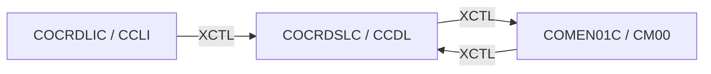

# Tesco | CICS Transaction: `CCDL` (Credit Card View)

> **Tesco | Mainframe Application Documentation**
> Application: **CardDemo** &nbsp;|&nbsp; Module: **Base application** &nbsp;|&nbsp; Classification: **Tesco Internal**
> Document owner: TODO: owning team &nbsp;|&nbsp; Last reviewed: 2026-11-13

Generated from [`docs/templates/TRANSACTION_DOC_TEMPLATE.md`](../templates/TRANSACTION_DOC_TEMPLATE.md). Back to the [transaction index](README.md).

---

## 1. Transaction ID

| Attribute | Value |
|:--|:--|
| Transaction ID | `CCDL` |
| CSD group | `CARDDEMO` |
| CSD definition | `app/csd/CARDDEMO.CSD` |
| CSD description | (none in CSD) |
| Profile / Tran class | `DFHCICST` / `DFHTCL00` |
| Other CSD attributes | `TASKDATALOC(ANY)`, `TASKDATAKEY(USER)`, `ISOLATE(YES)`, `RESSEC(NO)`, `CMDSEC(NO)` |
| README function | Credit Card View |

## 2. Program name

| Attribute | Value |
|:--|:--|
| Initial program | `COCRDSLC` |
| Source | [`app/cbl/COCRDSLC.cbl`](../../app/cbl/COCRDSLC.cbl) |
| Program type | CICS COBOL |
| Program header "Function" | Accept and process credit card detail request |

## 3. Mapset / BMS map

| Attribute | Value |
|:--|:--|
| Mapset | `COCRDSL` ([`app/bms/COCRDSL.bms`](../../app/bms/COCRDSL.bms)) |
| Map | `CCRDSLA` |
| Symbolic map copybook | [`app/cpy-bms/COCRDSL.CPY`](../../app/cpy-bms/COCRDSL.CPY) |

## 4. Purpose / Description

Read-only view of one credit card. Takes an account number and card number (entered or passed in from `CCLI`) and reads the card record from `CARDDAT` by card number, or through the `CARDAIX` alternate index by account.

## 5. Invocation

| Path | Detail |
|:--|:--|
| Menu path | `CC00` → `CM00` option 4 "Credit Card View", or `S` on a row in `CCLI`. |
| Direct tranid | With no COMMAREA the program starts a fresh COMMAREA and shows its screen. TODO: confirm the user/role context is set correctly when entered directly instead of through the menu. |
| Pseudo-conversational re-entry | `EXEC CICS RETURN TRANSID(CCDL) COMMAREA(...)` |

## 6. Inputs

### 6.1 COMMAREA

Shared CardDemo COMMAREA `CARDDEMO-COMMAREA` ([`app/cpy/COCOM01Y.cpy`](../../app/cpy/COCOM01Y.cpy)). Fields referenced by this program:

| Field | Picture | Usage |
|:--|:--|:--|
| `CDEMO-ACCT-ID` | `9(11)` | Account in context |
| `CDEMO-CARD-NUM` | `9(16)` | Card in context |
| `CDEMO-FROM-PROGRAM` | `X(08)` | Program of the calling screen (PF3 target) |
| `CDEMO-FROM-TRANID` | `X(04)` | Tranid of the calling screen |
| `CDEMO-LAST-MAP` | `X(7)` | Last map sent |
| `CDEMO-LAST-MAPSET` | `X(7)` | Last mapset sent |
| `CDEMO-TO-PROGRAM` | `X(08)` | Program to XCTL to |
| `CDEMO-TO-TRANID` | `X(04)` | Tranid to transfer to |

The program appends its own working fields after the shared area (paging keys, selection flags). See the program source for the layout.

### 6.2 Screen fields (unprotected)

| BMS field | Length | Label (same screen row) |
|:--|:--|:--|
| `ACCTSID` | 11 | Account Number |
| `CARDSID` | 16 | Card Number |

### 6.3 Function keys

| Key | Action |
|:--|:--|
| ENTER | Validate keys and display card |
| PF3 | Exit to the calling program (`CCLI`) or Main Menu |

## 7. Outputs

- **Screen:** `CRDNAME`, `CRDSTCD`, `EXPMON`, `EXPYEAR`, `INFOMSG`, `ERRMSG`, `FKEYS` (plus the standard header: `TITLE01`, `TITLE02`, `TRNNAME`, `PGMNAME`, `CURDATE`, `CURTIME`).
- **Messages** (literals found in the program):
  - "UNEXPECTED DATA SCENARIO"
  - "ACCOUNT FILTER,IF SUPPLIED MUST BE A 11 DIGIT NUMBER"
  - "CARD ID FILTER,IF SUPPLIED MUST BE A 16 DIGIT NUMBER"
  - "Displaying requested details"
  - "Please enter Account and Card Number"
  - "PF03 pressed.Exiting"
  - "Account number not provided"
  - "Card number not provided"
  - "No input received"
  - "Account number must be a non zero 11 digit number"
  - ... 5 more in the source.
- **Records written / messages sent:** None (read-only).

## 8. Data stores accessed

| Type | Resource | Physical name / definition | Record layout | Access |
|:--|:--|:--|:--|:--|
| VSAM | `CARDAIX` | `AWS.M2.CARDDEMO.CARDDATA.VSAM.AIX.PATH` | `CVACT02Y` (key: Account ID (alternate index path over CARDDAT)) | `READ` |
| VSAM | `CARDDAT` | `AWS.M2.CARDDEMO.CARDDATA.VSAM.KSDS` | `CVACT02Y` (key: Card number) | `READ` |

No DB2, IMS, MQ access found in `COCRDSLC`.

## 9. Called / linked programs (XCTL / LINK flow)

| Direction | Mechanism | Program (Tranid) | Condition |
|:--|:--|:--|:--|
| Outbound | XCTL | [`COMEN01C`](CM00.md) (`CM00`) | PF3 (exit): back to the Main Menu (or to `CDEMO-FROM-PROGRAM` when it was set by the caller) |
| Inbound | XCTL | [`COCRDLIC`](CCLI.md) (`CCLI`) | Row selected with `S`: card detail view (`CCDL`) |
| Inbound | XCTL | [`COMEN01C`](CM00.md) (`CM00`) | Menu selection |

## 10. Error handling

| Condition | Detection | Behaviour / message |
|:--|:--|:--|
| NOTFND | `DFHRESP(NOTFND)` | Record not found: message shown, key field highlighted |
| Any other CICS response | `RESP` / `RESP2` not handled above | Generic "unable to ..." message with the response code |
| Unexpected abend | `EXEC CICS HANDLE ABEND LABEL(ABEND-ROUTINE)` | Abend details sent to the terminal; then `EXEC CICS ABEND ABCODE(9999)` |
| Invalid key pressed | AID not in the list in 6.3 | Invalid-key message, screen re-sent |

## 11. Security / authorization

| Control | Detail |
|:--|:--|
| Sign-on | User must have signed on through `CC00` (`USRSEC`); identity travels in `CDEMO-USER-ID` / `CDEMO-USER-TYPE`. |
| Role / function | Shows card number, embossed name, status and expiry date. |
| CICS resource security | CSD `RESSEC(NO)`, `CMDSEC(NO)`: no CICS resource or command checks. |
| External security (RACF / ACF2 / Top Secret) | TODO: transaction profile for `CCDL` (TCICSTRN / GCICSTRN) owned by the Tesco security team. |

## 12. Change history

| Date | Version / commit | Author | Change |
|:--|:--|:--|:--|
| 2026-11-13 | - | Devin | Initial document generated from template and source inspection. |
| 2022-09-01 | `8c797e2` | Abhijit Kshirsagar | Last repository change to `COCRDSLC.cbl`: Release 1.0 |
| - | CSD | AWSUSER | CSD `DEFINETIME(22/04/08 11:11:43)`, `CHANGETIME(22/04/08 11:11:43)` |

## Open items (TODO)

- [ ] TODO: confirm external security (RACF) definitions for `CCDL`.
- [ ] TODO: assign a document owner.

---
*Tesco | Internal use only. Generated from `docs/templates/TRANSACTION_DOC_TEMPLATE.md`.*
