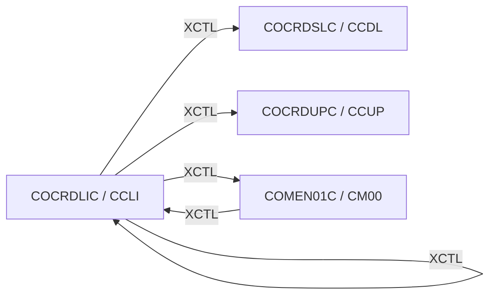

# Tesco | CICS Transaction: `CCLI` (Credit Card List)

> **Tesco | Mainframe Application Documentation**
> Application: **CardDemo** &nbsp;|&nbsp; Module: **Base application** &nbsp;|&nbsp; Classification: **Tesco Internal**
> Document owner: TODO: owning team &nbsp;|&nbsp; Last reviewed: 2026-11-13

Generated from [`docs/templates/TRANSACTION_DOC_TEMPLATE.md`](../templates/TRANSACTION_DOC_TEMPLATE.md). Back to the [transaction index](README.md).

---

## 1. Transaction ID

| Attribute | Value |
|:--|:--|
| Transaction ID | `CCLI` |
| CSD group | `CARDDEMO` |
| CSD definition | `app/csd/CARDDEMO.CSD` |
| CSD description | (none in CSD) |
| Profile / Tran class | `DFHCICST` / `DFHTCL00` |
| Other CSD attributes | `TASKDATALOC(ANY)`, `TASKDATAKEY(USER)`, `ISOLATE(YES)`, `RESSEC(NO)`, `CMDSEC(NO)` |
| README function | Credit Card List |

## 2. Program name

| Attribute | Value |
|:--|:--|
| Initial program | `COCRDLIC` |
| Source | [`app/cbl/COCRDLIC.cbl`](../../app/cbl/COCRDLIC.cbl) |
| Program type | CICS COBOL |
| Program header "Function" | List Credit Cards |

## 3. Mapset / BMS map

| Attribute | Value |
|:--|:--|
| Mapset | `COCRDLI` ([`app/bms/COCRDLI.bms`](../../app/bms/COCRDLI.bms)) |
| Map | `CCRDLIA` |
| Symbolic map copybook | [`app/cpy-bms/COCRDLI.CPY`](../../app/cpy-bms/COCRDLI.CPY) |

## 4. Purpose / Description

Pages through credit cards (`CARDDAT`, 7 rows per page). Admin users see all cards; regular users see the cards of the account in context. Optional account / card filters narrow the list. A row can be selected with `S` (view) or `U` (update).

## 5. Invocation

| Path | Detail |
|:--|:--|
| Menu path | `CC00` → `CM00` option 3 "Credit Card List". |
| Direct tranid | With no COMMAREA the program starts a fresh COMMAREA and shows its screen. TODO: confirm the user/role context is set correctly when entered directly instead of through the menu. |
| Pseudo-conversational re-entry | `EXEC CICS RETURN TRANSID(CCLI) COMMAREA(...)` |

## 6. Inputs

### 6.1 COMMAREA

Shared CardDemo COMMAREA `CARDDEMO-COMMAREA` ([`app/cpy/COCOM01Y.cpy`](../../app/cpy/COCOM01Y.cpy)). Fields referenced by this program:

| Field | Picture | Usage |
|:--|:--|:--|
| `CDEMO-ACCT-ID` | `9(11)` | Account in context |
| `CDEMO-CARD-NUM` | `9(16)` | Card in context |
| `CDEMO-FROM-PROGRAM` | `X(08)` | Program of the calling screen (PF3 target) |
| `CDEMO-FROM-TRANID` | `X(04)` | Tranid of the calling screen |
| `CDEMO-LAST-MAP` | `X(7)` | Last map sent |
| `CDEMO-LAST-MAPSET` | `X(7)` | Last mapset sent |
| `CDEMO-TO-PROGRAM` | `X(08)` | Program to XCTL to |

The program appends its own working fields after the shared area (paging keys, selection flags). See the program source for the layout.

### 6.2 Screen fields (unprotected)

| BMS field | Length | Label (same screen row) |
|:--|:--|:--|
| `ACCTSID` | 11 | Account Number |
| `CARDSID` | 16 | Credit Card Number |

### 6.3 Function keys

| Key | Action |
|:--|:--|
| ENTER | Apply filters / process row selection |
| PF7 | Previous page (`READPREV`) |
| PF8 | Next page (`READNEXT`) |
| PF3 | Exit to Main Menu |

## 7. Outputs

- **Screen:** `PAGENO`, `CRDSEL1`, `ACCTNO1`, `CRDNUM1`, `CRDSTS1`, `CRDSEL2`, `CRDSTP2`, `ACCTNO2`, `CRDNUM2`, `CRDSTS2`, `CRDSEL3`, `CRDSTP3`, `ACCTNO3`, `CRDNUM3`, `CRDSTS3`, `CRDSEL4`, `CRDSTP4`, `ACCTNO4`, `CRDNUM4`, `CRDSTS4`, `CRDSEL5`, `CRDSTP5`, `ACCTNO5`, `CRDNUM5`, `CRDSTS5`, `CRDSEL6`, `CRDSTP6`, `ACCTNO6`, `CRDNUM6`, `CRDSTS6`, `CRDSEL7`, `CRDSTP7`, `ACCTNO7`, `CRDNUM7`, `CRDSTS7`, `INFOMSG`, `ERRMSG` (plus the standard header: `TITLE01`, `TITLE02`, `TRNNAME`, `PGMNAME`, `CURDATE`, `CURTIME`).
- **Messages** (literals found in the program):
  - "NO PREVIOUS PAGES TO DISPLAY"
  - "NO MORE PAGES TO DISPLAY"
  - "ACCOUNT FILTER,IF SUPPLIED MUST BE A 11 DIGIT NUMBER"
  - "CARD ID FILTER,IF SUPPLIED MUST BE A 16 DIGIT NUMBER"
  - "NO MORE RECORDS TO SHOW"
  - "TYPE S FOR DETAIL, U TO UPDATE ANY RECORD"
  - "PF03 PRESSED.EXITING"
  - "NO RECORDS FOUND FOR THIS SEARCH CONDITION."
  - "PLEASE SELECT ONLY ONE RECORD TO VIEW OR UPDATE"
  - "INVALID ACTION CODE"
- **Records written / messages sent:** None (read-only).

## 8. Data stores accessed

| Type | Resource | Physical name / definition | Record layout | Access |
|:--|:--|:--|:--|:--|
| VSAM | `CARDDAT` | `AWS.M2.CARDDEMO.CARDDATA.VSAM.KSDS` | `CVACT02Y` (key: Card number) | `ENDBR`, `READNEXT`, `READPREV`, `STARTBR` |

No DB2, IMS, MQ access found in `COCRDLIC`.

## 9. Called / linked programs (XCTL / LINK flow)

| Direction | Mechanism | Program (Tranid) | Condition |
|:--|:--|:--|:--|
| Outbound | XCTL | [`COCRDLIC`](CCLI.md) (`CCLI`) | Re-entry of the list with the new COMMAREA |
| Outbound | XCTL | [`COCRDSLC`](CCDL.md) (`CCDL`) | Row selected with `S`: card detail view (`CCDL`) |
| Outbound | XCTL | [`COCRDUPC`](CCUP.md) (`CCUP`) | Row selected with `U`: card update (`CCUP`) |
| Outbound | XCTL | [`COMEN01C`](CM00.md) (`CM00`) | PF3 (exit): back to the Main Menu (or to `CDEMO-FROM-PROGRAM` when it was set by the caller) |
| Inbound | XCTL | [`COMEN01C`](CM00.md) (`CM00`) | Menu selection |

## 10. Error handling

| Condition | Detection | Behaviour / message |
|:--|:--|:--|
| DUPREC | `DFHRESP(DUPREC)` | Duplicate record on write: "already exists" message |
| ENDFILE | `DFHRESP(ENDFILE)` | End / start of file while paging: "no more records" message |
| Any other CICS response | `RESP` / `RESP2` not handled above | Generic "unable to ..." message with the response code |
| Invalid key pressed | AID not in the list in 6.3 | Invalid-key message, screen re-sent |

## 11. Security / authorization

| Control | Detail |
|:--|:--|
| Sign-on | User must have signed on through `CC00` (`USRSEC`); identity travels in `CDEMO-USER-ID` / `CDEMO-USER-TYPE`. |
| Role / function | Regular users are limited to cards of the account in context; admin (`CDEMO-USRTYP-ADMIN`) can list all cards. Shows full card numbers. |
| CICS resource security | CSD `RESSEC(NO)`, `CMDSEC(NO)`: no CICS resource or command checks. |
| External security (RACF / ACF2 / Top Secret) | TODO: transaction profile for `CCLI` (TCICSTRN / GCICSTRN) owned by the Tesco security team. |

## 12. Change history

| Date | Version / commit | Author | Change |
|:--|:--|:--|:--|
| 2026-11-13 | - | Devin | Initial document generated from template and source inspection. |
| 2022-09-01 | `8c797e2` | Abhijit Kshirsagar | Last repository change to `COCRDLIC.cbl`: Release 1.0 |
| - | CSD | AWSUSER | CSD `DEFINETIME(22/04/01 23:39:09)`, `CHANGETIME(22/04/01 23:39:09)` |

## Open items (TODO)

- [ ] TODO: confirm external security (RACF) definitions for `CCLI`.
- [ ] TODO: assign a document owner.

---
*Tesco | Internal use only. Generated from `docs/templates/TRANSACTION_DOC_TEMPLATE.md`.*
