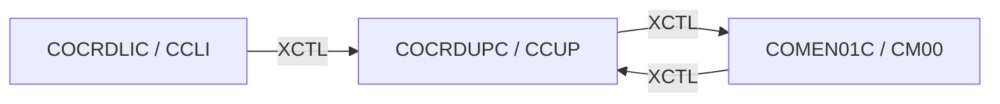

# Tesco | CICS Transaction: `CCUP` (Credit Card Update)

> **Tesco | Mainframe Application Documentation**
> Application: **CardDemo** &nbsp;|&nbsp; Module: **Base application** &nbsp;|&nbsp; Classification: **Tesco Internal**
> Document owner: TODO: owning team &nbsp;|&nbsp; Last reviewed: 2026-11-13

Generated from [`docs/templates/TRANSACTION_DOC_TEMPLATE.md`](../templates/TRANSACTION_DOC_TEMPLATE.md). Back to the [transaction index](README.md).

---

## 1. Transaction ID

| Attribute | Value |
|:--|:--|
| Transaction ID | `CCUP` |
| CSD group | `CARDDEMO` |
| CSD definition | `app/csd/CARDDEMO.CSD` |
| CSD description | CREDIT CARD UPDATE TRANSACTION |
| Profile / Tran class | `DFHCICST` / `DFHTCL00` |
| Other CSD attributes | `TASKDATALOC(ANY)`, `TASKDATAKEY(USER)`, `ISOLATE(YES)`, `RESSEC(NO)`, `CMDSEC(NO)` |
| README function | Credit Card Update |

## 2. Program name

| Attribute | Value |
|:--|:--|
| Initial program | `COCRDUPC` |
| Source | [`app/cbl/COCRDUPC.cbl`](../../app/cbl/COCRDUPC.cbl) |
| Program type | CICS COBOL |
| Program header "Function" | Accept and process credit card detail request |

## 3. Mapset / BMS map

| Attribute | Value |
|:--|:--|
| Mapset | `COCRDUP` ([`app/bms/COCRDUP.bms`](../../app/bms/COCRDUP.bms)) |
| Map | `CCRDUPA` |
| Symbolic map copybook | [`app/cpy-bms/COCRDUP.CPY`](../../app/cpy-bms/COCRDUP.CPY) |

## 4. Purpose / Description

Update a credit card: embossed name, active status and expiry date. The card is read, changes are validated, the user confirms, and the record is rewritten in `CARDDAT` after a `READ UPDATE`, with a check that nobody else changed it in the meantime.

## 5. Invocation

| Path | Detail |
|:--|:--|
| Menu path | `CC00` → `CM00` option 5 "Credit Card Update", or `U` on a row in `CCLI`. |
| Direct tranid | With no COMMAREA the program starts a fresh COMMAREA and shows its screen. TODO: confirm the user/role context is set correctly when entered directly instead of through the menu. |
| Pseudo-conversational re-entry | `EXEC CICS RETURN TRANSID(CCUP) COMMAREA(...)` |

## 6. Inputs

### 6.1 COMMAREA

Shared CardDemo COMMAREA `CARDDEMO-COMMAREA` ([`app/cpy/COCOM01Y.cpy`](../../app/cpy/COCOM01Y.cpy)). Fields referenced by this program:

| Field | Picture | Usage |
|:--|:--|:--|
| `CDEMO-ACCT-ID` | `9(11)` | Account in context |
| `CDEMO-ACCT-STATUS` | `X(01)` | Account status |
| `CDEMO-CARD-NUM` | `9(16)` | Card in context |
| `CDEMO-FROM-PROGRAM` | `X(08)` | Program of the calling screen (PF3 target) |
| `CDEMO-FROM-TRANID` | `X(04)` | Tranid of the calling screen |
| `CDEMO-LAST-MAP` | `X(7)` | Last map sent |
| `CDEMO-LAST-MAPSET` | `X(7)` | Last mapset sent |
| `CDEMO-TO-PROGRAM` | `X(08)` | Program to XCTL to |
| `CDEMO-TO-TRANID` | `X(04)` | Tranid to transfer to |

The program appends its own working fields after the shared area (paging keys, selection flags). See the program source for the layout.

### 6.2 Screen fields (unprotected)

| BMS field | Length | Label (same screen row) |
|:--|:--|:--|
| `CARDSID` | 16 | Card Number |
| `CRDNAME` | 50 | Name on card |
| `CRDSTCD` | 1 | Card Active Y/N |
| `EXPMON` | 2 | Expiry Date |
| `EXPYEAR` | 4 | / |

### 6.3 Function keys

| Key | Action |
|:--|:--|
| ENTER | Fetch card / validate changes |
| PF5 | Confirm and save |
| PF12 | Cancel changes |
| PF3 | Exit to the calling program (`CCLI`) or Main Menu |

## 7. Outputs

- **Screen:** `ACCTSID`, `EXPDAY`, `INFOMSG`, `ERRMSG`, `FKEYS`, `FKEYSC` (plus the standard header: `TITLE01`, `TITLE02`, `TRNNAME`, `PGMNAME`, `CURDATE`, `CURTIME`).
- **Messages** (literals found in the program):
  - "ACCOUNT FILTER,IF SUPPLIED MUST BE A 11 DIGIT NUMBER"
  - "CARD ID FILTER,IF SUPPLIED MUST BE A 16 DIGIT NUMBER"
  - "Details of selected card shown above"
  - "Please enter Account and Card Number"
  - "Update card details presented above."
  - "Changes validated.Press F5 to save"
  - "Changes committed to database"
  - "Changes unsuccessful. Please try again"
  - "PF03 pressed.Exiting"
  - "Account number not provided"
  - ... 17 more in the source.
- **Records written / messages sent:** `CARDDAT` (REWRITE)

## 8. Data stores accessed

| Type | Resource | Physical name / definition | Record layout | Access |
|:--|:--|:--|:--|:--|
| VSAM | `CARDDAT` | `AWS.M2.CARDDEMO.CARDDATA.VSAM.KSDS` | `CVACT02Y` (key: Card number) | `READ`, `READ UPDATE`, `REWRITE` |

No DB2, IMS, MQ access found in `COCRDUPC`.

## 9. Called / linked programs (XCTL / LINK flow)

| Direction | Mechanism | Program (Tranid) | Condition |
|:--|:--|:--|:--|
| Outbound | XCTL | [`COMEN01C`](CM00.md) (`CM00`) | PF3 (exit): back to the Main Menu (or to `CDEMO-FROM-PROGRAM` when it was set by the caller) |
| Inbound | XCTL | [`COCRDLIC`](CCLI.md) (`CCLI`) | Row selected with `U`: card update (`CCUP`) |
| Inbound | XCTL | [`COMEN01C`](CM00.md) (`CM00`) | Menu selection |

## 10. Error handling

| Condition | Detection | Behaviour / message |
|:--|:--|:--|
| NOTFND | `DFHRESP(NOTFND)` | Record not found: message shown, key field highlighted |
| Any other CICS response | `RESP` / `RESP2` not handled above | Generic "unable to ..." message with the response code |
| Unexpected abend | `EXEC CICS HANDLE ABEND LABEL(ABEND-ROUTINE)` | Abend details sent to the terminal; then `EXEC CICS ABEND ABCODE(9999)` |
| Invalid key pressed | AID not in the list in 6.3 | Invalid-key message, screen re-sent |

## 11. Security / authorization

| Control | Detail |
|:--|:--|
| Sign-on | User must have signed on through `CC00` (`USRSEC`); identity travels in `CDEMO-USER-ID` / `CDEMO-USER-TYPE`. |
| Role / function | Changes card status (can activate / deactivate a card). |
| CICS resource security | CSD `RESSEC(NO)`, `CMDSEC(NO)`: no CICS resource or command checks. |
| External security (RACF / ACF2 / Top Secret) | TODO: transaction profile for `CCUP` (TCICSTRN / GCICSTRN) owned by the Tesco security team. |

## 12. Change history

| Date | Version / commit | Author | Change |
|:--|:--|:--|:--|
| 2026-11-13 | - | Devin | Initial document generated from template and source inspection. |
| 2022-09-01 | `8c797e2` | Abhijit Kshirsagar | Last repository change to `COCRDUPC.cbl`: Release 1.0 |
| - | CSD | AWSUSER | CSD `DEFINETIME(22/05/07 16:02:59)`, `CHANGETIME(22/05/07 16:03:06)` |

## Open items (TODO)

- [ ] TODO: confirm external security (RACF) definitions for `CCUP`.
- [ ] TODO: assign a document owner.

---
*Tesco | Internal use only. Generated from `docs/templates/TRANSACTION_DOC_TEMPLATE.md`.*
