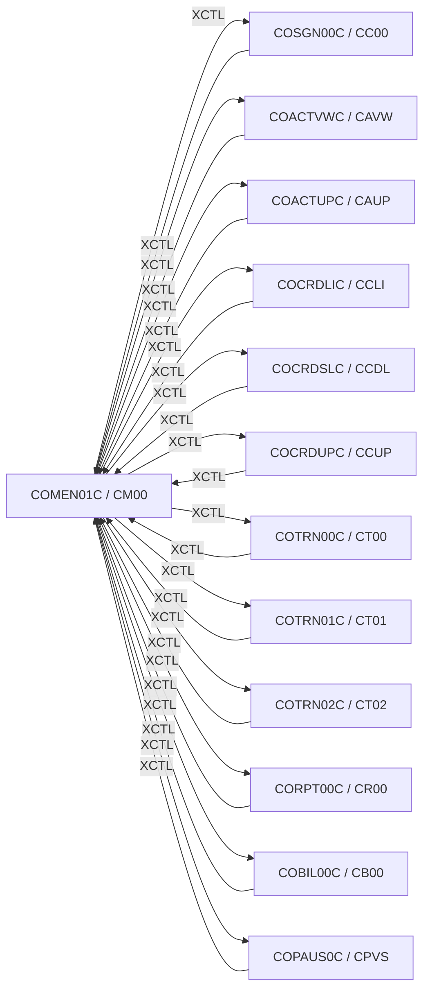

# Tesco | CICS Transaction: `CM00` (Main Menu)

> **Tesco | Mainframe Application Documentation**
> Application: **CardDemo** &nbsp;|&nbsp; Module: **Base application** &nbsp;|&nbsp; Classification: **Tesco Internal**
> Document owner: TODO: owning team &nbsp;|&nbsp; Last reviewed: 2026-11-13

Generated from [`docs/templates/TRANSACTION_DOC_TEMPLATE.md`](../templates/TRANSACTION_DOC_TEMPLATE.md). Back to the [transaction index](README.md).

---

## 1. Transaction ID

| Attribute | Value |
|:--|:--|
| Transaction ID | `CM00` |
| CSD group | `CARDDEMO` |
| CSD definition | `app/csd/CARDDEMO.CSD` |
| CSD description | (none in CSD) |
| Profile / Tran class | `DFHCICST` / `DFHTCL00` |
| Other CSD attributes | `TASKDATALOC(ANY)`, `TASKDATAKEY(USER)`, `ISOLATE(YES)`, `RESSEC(NO)`, `CMDSEC(NO)` |
| README function | Main Menu |

## 2. Program name

| Attribute | Value |
|:--|:--|
| Initial program | `COMEN01C` |
| Source | [`app/cbl/COMEN01C.cbl`](../../app/cbl/COMEN01C.cbl) |
| Program type | CICS COBOL |
| Program header "Function" | Main Menu for the Regular users |

## 3. Mapset / BMS map

| Attribute | Value |
|:--|:--|
| Mapset | `COMEN01` ([`app/bms/COMEN01.bms`](../../app/bms/COMEN01.bms)) |
| Map | `COMEN1A` |
| Symbolic map copybook | [`app/cpy-bms/COMEN01.CPY`](../../app/cpy-bms/COMEN01.CPY) |

## 4. Purpose / Description

Main menu for regular users. Lists the options from copybook `COMEN02Y`, validates the selected option number and transfers control (XCTL) to the program behind that option.

## 5. Invocation

| Path | Detail |
|:--|:--|
| Menu path | `CC00` sign-on (regular user) → `CM00`. Every user function returns here with PF3. |
| Direct tranid | Typing the tranid with no COMMAREA (`EIBCALEN = 0`) sends the user back to the sign-on screen (`COSGN00C`). Use the menu path. |
| Pseudo-conversational re-entry | `EXEC CICS RETURN TRANSID(CM00) COMMAREA(...)` |

## 6. Inputs

### 6.1 COMMAREA

Shared CardDemo COMMAREA `CARDDEMO-COMMAREA` ([`app/cpy/COCOM01Y.cpy`](../../app/cpy/COCOM01Y.cpy)). Fields referenced by this program:

| Field | Picture | Usage |
|:--|:--|:--|
| `CDEMO-FROM-PROGRAM` | `X(08)` | Program of the calling screen (PF3 target) |
| `CDEMO-FROM-TRANID` | `X(04)` | Tranid of the calling screen |
| `CDEMO-PGM-CONTEXT` | `9(01)` | `0` first entry / `1` re-entry |
| `CDEMO-TO-PROGRAM` | `X(08)` | Program to XCTL to |

### 6.2 Screen fields (unprotected)

| BMS field | Length | Label (same screen row) |
|:--|:--|:--|
| `OPTION` | 2 | Please select an option |

### 6.3 Function keys

| Key | Action |
|:--|:--|
| ENTER | Validate option number and XCTL to the selected program |
| PF3 | Sign off: back to `COSGN00C` (`CC00`) |

## 7. Outputs

- **Screen:** `OPTN001`, `OPTN002`, `OPTN003`, `OPTN004`, `OPTN005`, `OPTN006`, `OPTN007`, `OPTN008`, `OPTN009`, `OPTN010`, `OPTN011`, `OPTN012`, `ERRMSG` (plus the standard header: `TITLE01`, `TITLE02`, `TRNNAME`, `PGMNAME`, `CURDATE`, `CURTIME`).
- **Messages** (literals found in the program):
  - "Please enter a valid option number..."
  - "No access - Admin Only option..."
- **Records written / messages sent:** None (read-only).

## 8. Data stores accessed

None.

No DB2, IMS, MQ access found in `COMEN01C`.

## 9. Called / linked programs (XCTL / LINK flow)

| Direction | Mechanism | Program (Tranid) | Condition |
|:--|:--|:--|:--|
| Outbound | XCTL | [`COSGN00C`](CC00.md) (`CC00`) | No COMMAREA (EIBCALEN = 0) or PF3 on a menu: back to sign-on |
| Outbound | XCTL | [`COACTVWC`](CAVW.md) (`CAVW`) | Menu option 1 "Account View" |
| Outbound | XCTL | [`COACTUPC`](CAUP.md) (`CAUP`) | Menu option 2 "Account Update" |
| Outbound | XCTL | [`COCRDLIC`](CCLI.md) (`CCLI`) | Menu option 3 "Credit Card List" |
| Outbound | XCTL | [`COCRDSLC`](CCDL.md) (`CCDL`) | Menu option 4 "Credit Card View" |
| Outbound | XCTL | [`COCRDUPC`](CCUP.md) (`CCUP`) | Menu option 5 "Credit Card Update" |
| Outbound | XCTL | [`COTRN00C`](CT00.md) (`CT00`) | Menu option 6 "Transaction List" |
| Outbound | XCTL | [`COTRN01C`](CT01.md) (`CT01`) | Menu option 7 "Transaction View" |
| Outbound | XCTL | [`COTRN02C`](CT02.md) (`CT02`) | Menu option 8 "Transaction Add" |
| Outbound | XCTL | [`CORPT00C`](CR00.md) (`CR00`) | Menu option 9 "Transaction Reports" |
| Outbound | XCTL | [`COBIL00C`](CB00.md) (`CB00`) | Menu option 10 "Bill Payment" |
| Outbound | XCTL | [`COPAUS0C`](CPVS.md) (`CPVS`) | Menu option 11 "Pending Authorization View" |
| Inbound | XCTL | [`COACTUPC`](CAUP.md) (`CAUP`) | Return (PF3) or navigation from that screen |
| Inbound | XCTL | [`COACTVWC`](CAVW.md) (`CAVW`) | Return (PF3) or navigation from that screen |
| Inbound | XCTL | [`COBIL00C`](CB00.md) (`CB00`) | Return (PF3) or navigation from that screen |
| Inbound | XCTL | [`COCRDLIC`](CCLI.md) (`CCLI`) | Return (PF3) or navigation from that screen |
| Inbound | XCTL | [`COCRDSLC`](CCDL.md) (`CCDL`) | Return (PF3) or navigation from that screen |
| Inbound | XCTL | [`COCRDUPC`](CCUP.md) (`CCUP`) | Return (PF3) or navigation from that screen |
| Inbound | XCTL | [`COPAUS0C`](CPVS.md) (`CPVS`) | Return (PF3) or navigation from that screen |
| Inbound | XCTL | [`CORPT00C`](CR00.md) (`CR00`) | Return (PF3) or navigation from that screen |
| Inbound | XCTL | [`COSGN00C`](CC00.md) (`CC00`) | Sign-on OK and user type = `U` (regular user) |
| Inbound | XCTL | [`COTRN00C`](CT00.md) (`CT00`) | Return (PF3) or navigation from that screen |
| Inbound | XCTL | [`COTRN01C`](CT01.md) (`CT01`) | Return (PF3) or navigation from that screen |
| Inbound | XCTL | [`COTRN02C`](CT02.md) (`CT02`) | Return (PF3) or navigation from that screen |

## 10. Error handling

| Condition | Detection | Behaviour / message |
|:--|:--|:--|
| Any other CICS response | `RESP` / `RESP2` not handled above | Generic "unable to ..." message with the response code |
| Invalid key pressed | AID not in the list in 6.3 | Invalid-key message, screen re-sent |

## 11. Security / authorization

| Control | Detail |
|:--|:--|
| Sign-on | User must have signed on through `CC00` (`USRSEC`); identity travels in `CDEMO-USER-ID` / `CDEMO-USER-TYPE`. |
| Role / function | Options flagged `A` in `CDEMO-MENU-OPT-USRTYPE` are refused for regular users ("No access - Admin Only option..."). Option 11 (`COPAUS0C`) is checked with `EXEC CICS INQUIRE PROGRAM`; if the optional authorization module is not installed a "not installed" message is shown instead of an XCTL. |
| CICS resource security | CSD `RESSEC(NO)`, `CMDSEC(NO)`: no CICS resource or command checks. |
| External security (RACF / ACF2 / Top Secret) | TODO: transaction profile for `CM00` (TCICSTRN / GCICSTRN) owned by the Tesco security team. |

## 12. Change history

| Date | Version / commit | Author | Change |
|:--|:--|:--|:--|
| 2026-11-13 | - | Devin | Initial document generated from template and source inspection. |
| 2025-08-03 | `fb78417` | Arunkumar Selvam | Last repository change to `COMEN01C.cbl`: Add optional modules and enhanced functionality |
| - | CSD | AWSUSER | CSD `DEFINETIME(22/03/15 00:25:46)`, `CHANGETIME(22/03/15 00:25:46)` |

## Open items (TODO)

- [ ] TODO: confirm external security (RACF) definitions for `CM00`.
- [ ] TODO: assign a document owner.

---
*Tesco | Internal use only. Generated from `docs/templates/TRANSACTION_DOC_TEMPLATE.md`.*
