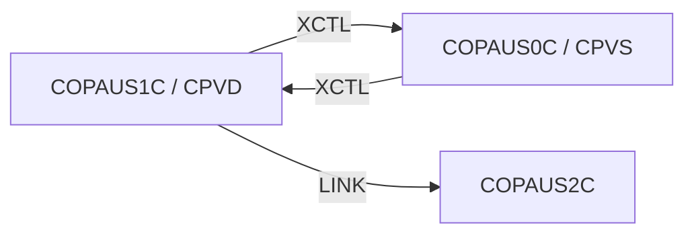

# Tesco | CICS Transaction: `CPVD` (Pending Authorization Details)

> **Tesco | Mainframe Application Documentation**
> Application: **CardDemo** &nbsp;|&nbsp; Module: **IMS-DB2-MQ: Pending Authorizations** &nbsp;|&nbsp; Classification: **Tesco Internal**
> Document owner: TODO: owning team &nbsp;|&nbsp; Last reviewed: 2026-11-13

Generated from [`docs/templates/TRANSACTION_DOC_TEMPLATE.md`](../templates/TRANSACTION_DOC_TEMPLATE.md). Back to the [transaction index](README.md).

---

## 1. Transaction ID

| Attribute | Value |
|:--|:--|
| Transaction ID | `CPVD` |
| CSD group | `CARDDEMO` |
| CSD definition | `app/app-authorization-ims-db2-mq/csd/CRDDEMO2.csd` |
| CSD description | (none in CSD) |
| Profile / Tran class | `DFHCICST` / `DFHTCL00` |
| Other CSD attributes | `TASKDATALOC(ANY)`, `TASKDATAKEY(USER)`, `ISOLATE(YES)`, `RESSEC(NO)`, `CMDSEC(NO)` |
| README function | Pending Authorization Details (Update IMS and Insert DB2) |

## 2. Program name

| Attribute | Value |
|:--|:--|
| Initial program | `COPAUS1C` |
| Source | [`app/app-authorization-ims-db2-mq/cbl/COPAUS1C.cbl`](../../app/app-authorization-ims-db2-mq/cbl/COPAUS1C.cbl) |
| Program type | CICS COBOL + Db2 (through `COPAUS2C`) + IMS DL/I |
| Program header "Function" | Detail View of Authorization Message |

## 3. Mapset / BMS map

| Attribute | Value |
|:--|:--|
| Mapset | `COPAU01` ([`app/app-authorization-ims-db2-mq/bms/COPAU01.bms`](../../app/app-authorization-ims-db2-mq/bms/COPAU01.bms)) |
| Map | `COPAU1A` |
| Symbolic map copybook | [`app/app-authorization-ims-db2-mq/cpy-bms/COPAU01.cpy`](../../app/app-authorization-ims-db2-mq/cpy-bms/COPAU01.cpy) |

## 4. Purpose / Description

Shows one pending authorization in full (card, amount, merchant, response and reason codes). PF5 toggles the fraud flag: the detail segment is updated in IMS (`REPL` on `PAUTDTL1`) and program `COPAUS2C` is LINKed to insert or update the fraud record in Db2 table `CARDDEMO.AUTHFRDS`. PF8 moves to the next authorization for the same account.

## 5. Invocation

| Path | Detail |
|:--|:--|
| Menu path | `CPVS` → select a row with `S`. |
| Direct tranid | Not designed for direct entry; it expects the account and authorization key in the COMMAREA from `CPVS`. |
| Pseudo-conversational re-entry | `EXEC CICS RETURN TRANSID(CPVD) COMMAREA(...)` |

## 6. Inputs

### 6.1 COMMAREA

Shared CardDemo COMMAREA `CARDDEMO-COMMAREA` ([`app/cpy/COCOM01Y.cpy`](../../app/cpy/COCOM01Y.cpy)). Fields referenced by this program:

| Field | Picture | Usage |
|:--|:--|:--|
| `CDEMO-ACCT-ID` | `9(11)` | Account in context |
| `CDEMO-CUST-ID` | `9(09)` | Customer in context |
| `CDEMO-FROM-PROGRAM` | `X(08)` | Program of the calling screen (PF3 target) |
| `CDEMO-FROM-TRANID` | `X(04)` | Tranid of the calling screen |
| `CDEMO-PGM-CONTEXT` | `9(01)` | `0` first entry / `1` re-entry |
| `CDEMO-TO-PROGRAM` | `X(08)` | Program to XCTL to |

### 6.2 Screen fields (unprotected)

None. The map has no unprotected input fields (navigation by function keys only).

### 6.3 Function keys

| Key | Action |
|:--|:--|
| ENTER | Re-display the selected authorization |
| PF3 | Back to the summary (`CPVS`) |
| PF5 | Mark / unmark as fraud (IMS `REPL` + LINK `COPAUS2C`) |
| PF8 | Next authorization |

## 7. Outputs

- **Screen:** `CARDNUM`, `AUTHDT`, `AUTHTM`, `AUTHRSP`, `AUTHRSN`, `AUTHCD`, `AUTHAMT`, `POSEMD`, `AUTHSRC`, `MCCCD`, `CRDEXP`, `AUTHTYP`, `TRNID`, `AUTHMTC`, `AUTHFRD`, `MERNAME`, `MERID`, `MERCITY`, `MERST`, `MERZIP`, `ERRMSG` (plus the standard header: `TITLE01`, `TITLE02`, `TRNNAME`, `PGMNAME`, `CURDATE`, `CURTIME`).
- **Messages** (literals found in the program):
  - "Already at the last Authorization..."
  - "AUTH FRAUD REMOVED..."
  - "AUTH MARKED FRAUD..."
- **Records written / messages sent:** IMS `PAUTDTL1` replaced; Db2 `CARDDEMO.AUTHFRDS` row inserted / updated by `COPAUS2C`.

## 8. Data stores accessed

| Type | Resource | Physical name / definition | Record layout | Access |
|:--|:--|:--|:--|:--|
| IMS | `PAUTSUM0` | DBD `DBPAUTP0`, PSB `PSBPAUTB` | `CIPAUSMY` | `SCHD`, `GU`, `TERM` |
| IMS | `PAUTDTL1` | DBD `DBPAUTP0`, PSB `PSBPAUTB` | `CIPAUDTY` | `GU`, `GNP`, `REPL` |
| DB2 | `CARDDEMO.AUTHFRDS` (through LINK to `COPAUS2C`) | `app/app-authorization-ims-db2-mq/ddl/AUTHFRDS.ddl`, index `XAUTHFRD.ddl` | `app/app-authorization-ims-db2-mq/dcl/AUTHFRDS.dcl` | `INSERT`; `UPDATE` (sets `AUTH_FRAUD`, `FRAUD_RPT_DATE`) when the row already exists |

No MQ access found in `COPAUS1C`.

## 9. Called / linked programs (XCTL / LINK flow)

| Direction | Mechanism | Program (Tranid) | Condition |
|:--|:--|:--|:--|
| Outbound | XCTL | [`COPAUS0C`](CPVS.md) (`CPVS`) | PF3: back to the summary (`CPVS`) |
| Outbound | LINK | `COPAUS2C` | PF5: record fraud in Db2 (`CARDDEMO.AUTHFRDS`) |
| Inbound | XCTL | [`COPAUS0C`](CPVS.md) (`CPVS`) | Row selected with `S`: authorization details (`CPVD`) |

## 10. Error handling

| Condition | Detection | Behaviour / message |
|:--|:--|:--|
| Any other CICS response | `RESP` / `RESP2` not handled above | Generic "unable to ..." message with the response code |
| Invalid key pressed | AID not in the list in 6.3 | Invalid-key message, screen re-sent |

## 11. Security / authorization

| Control | Detail |
|:--|:--|
| Sign-on | User must have signed on through `CC00` (`USRSEC`); identity travels in `CDEMO-USER-ID` / `CDEMO-USER-TYPE`. |
| Role / function | Fraud marking changes the authorization status that downstream processes rely on. TODO: confirm who is allowed to mark fraud (no role check in the program). |
| CICS resource security | CSD `RESSEC(NO)`, `CMDSEC(NO)`: no CICS resource or command checks. |
| External security (RACF / ACF2 / Top Secret) | TODO: transaction profile for `CPVD` (TCICSTRN / GCICSTRN) owned by the Tesco security team. |

## 12. Change history

| Date | Version / commit | Author | Change |
|:--|:--|:--|:--|
| 2026-11-13 | - | Devin | Initial document generated from template and source inspection. |
| 2025-08-03 | `fb78417` | Arunkumar Selvam | Last repository change to `COPAUS1C.cbl`: Add optional modules and enhanced functionality |
| - | CSD | AWSUSER | CSD `DEFINETIME(23/03/13 15:32:24)`, `CHANGETIME(23/03/13 15:32:51)` |

## Open items (TODO)

- [ ] TODO: confirm external security (RACF) definitions for `CPVD`.
- [ ] TODO: assign a document owner.

---
*Tesco | Internal use only. Generated from `docs/templates/TRANSACTION_DOC_TEMPLATE.md`.*
