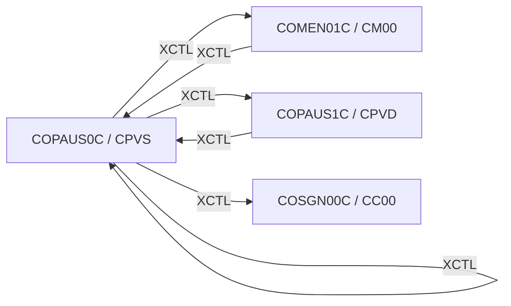

# Tesco | CICS Transaction: `CPVS` (Pending Authorization Summary)

> **Tesco | Mainframe Application Documentation**
> Application: **CardDemo** &nbsp;|&nbsp; Module: **IMS-DB2-MQ: Pending Authorizations** &nbsp;|&nbsp; Classification: **Tesco Internal**
> Document owner: TODO: owning team &nbsp;|&nbsp; Last reviewed: 2026-11-13

Generated from [`docs/templates/TRANSACTION_DOC_TEMPLATE.md`](../templates/TRANSACTION_DOC_TEMPLATE.md). Back to the [transaction index](README.md).

---

## 1. Transaction ID

| Attribute | Value |
|:--|:--|
| Transaction ID | `CPVS` |
| CSD group | `CARDDEMO` |
| CSD definition | `app/app-authorization-ims-db2-mq/csd/CRDDEMO2.csd` |
| CSD description | (none in CSD) |
| Profile / Tran class | `DFHCICST` / `DFHTCL00` |
| Other CSD attributes | `TASKDATALOC(ANY)`, `TASKDATAKEY(USER)`, `ISOLATE(YES)`, `RESSEC(NO)`, `CMDSEC(NO)` |
| README function | Pending Authorization Summary (Read IMS and VSAM) |

## 2. Program name

| Attribute | Value |
|:--|:--|
| Initial program | `COPAUS0C` |
| Source | [`app/app-authorization-ims-db2-mq/cbl/COPAUS0C.cbl`](../../app/app-authorization-ims-db2-mq/cbl/COPAUS0C.cbl) |
| Program type | CICS COBOL + IMS DL/I |
| Program header "Function" | Summary View of Authoriation Messages |

## 3. Mapset / BMS map

| Attribute | Value |
|:--|:--|
| Mapset | `COPAU00` ([`app/app-authorization-ims-db2-mq/bms/COPAU00.bms`](../../app/app-authorization-ims-db2-mq/bms/COPAU00.bms)) |
| Map | `COPAU0A` |
| Symbolic map copybook | [`app/app-authorization-ims-db2-mq/cpy-bms/COPAU00.cpy`](../../app/app-authorization-ims-db2-mq/cpy-bms/COPAU00.cpy) |

## 4. Purpose / Description

Shows the pending card authorizations for an account. The account and customer are read from VSAM (`CXACAIX`, `ACCTDAT`, `CUSTDAT`); the authorization summary segment `PAUTSUM0` and its child detail segments `PAUTDTL1` are read from IMS database `DBPAUTP0` through PSB `PSBPAUTB`, five per page. Selecting a row with `S` opens the details screen (`CPVD`).

## 5. Invocation

| Path | Detail |
|:--|:--|
| Menu path | `CC00` → `CM00` option 11 "Pending Authorization View" (only when the module is installed). |
| Direct tranid | With no COMMAREA the program starts a fresh COMMAREA and shows its screen. TODO: confirm the user/role context is set correctly when entered directly instead of through the menu. |
| Pseudo-conversational re-entry | `EXEC CICS RETURN TRANSID(CPVS) COMMAREA(...)` |

## 6. Inputs

### 6.1 COMMAREA

Shared CardDemo COMMAREA `CARDDEMO-COMMAREA` ([`app/cpy/COCOM01Y.cpy`](../../app/cpy/COCOM01Y.cpy)). Fields referenced by this program:

| Field | Picture | Usage |
|:--|:--|:--|
| `CDEMO-ACCT-ID` | `9(11)` | Account in context |
| `CDEMO-CARD-NUM` | `9(16)` | Card in context |
| `CDEMO-CUST-ID` | `9(09)` | Customer in context |
| `CDEMO-FROM-PROGRAM` | `X(08)` | Program of the calling screen (PF3 target) |
| `CDEMO-FROM-TRANID` | `X(04)` | Tranid of the calling screen |
| `CDEMO-PGM-CONTEXT` | `9(01)` | `0` first entry / `1` re-entry |
| `CDEMO-TO-PROGRAM` | `X(08)` | Program to XCTL to |

### 6.2 Screen fields (unprotected)

| BMS field | Length | Label (same screen row) |
|:--|:--|:--|
| `ACCTID` | 11 | Search Acct Id |
| `SEL0001` | 1 |  |
| `SEL0002` | 1 |  |
| `SEL0003` | 1 |  |
| `SEL0004` | 1 |  |
| `SEL0005` | 1 |  |

### 6.3 Function keys

| Key | Action |
|:--|:--|
| ENTER | Look up the account / process row selection |
| PF3 | Back to Main Menu |
| PF7 | Previous page |
| PF8 | Next page |

## 7. Outputs

- **Screen:** `CNAME`, `CUSTID`, `ADDR001`, `ACCSTAT`, `ADDR002`, `PHONE1`, `APPRCNT`, `DECLCNT`, `CREDLIM`, `CASHLIM`, `APPRAMT`, `CREDBAL`, `CASHBAL`, `DECLAMT`, `TRNID01`, `PDATE01`, `PTIME01`, `PTYPE01`, `PAPRV01`, `PSTAT01`, `PAMT001`, `TRNID02`, `PDATE02`, `PTIME02`, `PTYPE02`, `PAPRV02`, `PSTAT02`, `PAMT002`, `TRNID03`, `PDATE03`, `PTIME03`, `PTYPE03`, `PAPRV03`, `PSTAT03`, `PAMT003`, `TRNID04`, `PDATE04`, `PTIME04`, `PTYPE04`, `PAPRV04`, `PSTAT04`, `PAMT004`, `TRNID05`, `PDATE05`, `PTIME05`, `PTYPE05`, `PAPRV05`, `PSTAT05`, `PAMT005`, `ERRMSG` (plus the standard header: `TITLE01`, `TITLE02`, `TRNNAME`, `PGMNAME`, `CURDATE`, `CURTIME`).
- **Messages** (literals found in the program):
  - "Please enter Acct Id..."
  - "Acct Id must be Numeric ..."
  - "Invalid selection. Valid value is S"
  - "You are already at the top of the page..."
  - "You are already at the bottom of the page..."
- **Records written / messages sent:** None (read-only).

## 8. Data stores accessed

| Type | Resource | Physical name / definition | Record layout | Access |
|:--|:--|:--|:--|:--|
| VSAM | `ACCTDAT` | `AWS.M2.CARDDEMO.ACCTDATA.VSAM.KSDS` | `CVACT01Y` (key: Account ID) | `READ` |
| VSAM | `CUSTDAT` | `AWS.M2.CARDDEMO.CUSTDATA.VSAM.KSDS` | `CVCUS01Y` (key: Customer ID) | `READ` |
| VSAM | `CXACAIX` | `AWS.M2.CARDDEMO.CARDXREF.VSAM.AIX.PATH` | `CVACT03Y` (key: Account ID (alternate index path over CCXREF)) | `READ` |
| IMS | `PAUTSUM0` (root) | DBD `DBPAUTP0`, PSB `PSBPAUTB` (`app/app-authorization-ims-db2-mq/ims/`) | `CIPAUSMY` | `SCHD`, `GU`, `TERM` |
| IMS | `PAUTDTL1` (child of `PAUTSUM0`) | DBD `DBPAUTP0`, PSB `PSBPAUTB` | `CIPAUDTY` | `GNP` |

No DB2, MQ access found in `COPAUS0C`.

## 9. Called / linked programs (XCTL / LINK flow)

| Direction | Mechanism | Program (Tranid) | Condition |
|:--|:--|:--|:--|
| Outbound | XCTL | [`COMEN01C`](CM00.md) (`CM00`) | PF3 (exit): back to the Main Menu (or to `CDEMO-FROM-PROGRAM` when it was set by the caller) |
| Outbound | XCTL | [`COPAUS0C`](CPVS.md) (`CPVS`) | Re-entry / refresh of the summary |
| Outbound | XCTL | [`COPAUS1C`](CPVD.md) (`CPVD`) | Row selected with `S`: authorization details (`CPVD`) |
| Outbound | XCTL | [`COSGN00C`](CC00.md) (`CC00`) | No COMMAREA (EIBCALEN = 0) or PF3 on a menu: back to sign-on |
| Inbound | XCTL | [`COMEN01C`](CM00.md) (`CM00`) | Menu selection |
| Inbound | XCTL | [`COPAUS1C`](CPVD.md) (`CPVD`) | PF3: back to the summary (`CPVS`) |

## 10. Error handling

| Condition | Detection | Behaviour / message |
|:--|:--|:--|
| NOTFND | `DFHRESP(NOTFND)` | Record not found: message shown, key field highlighted |
| Any other CICS response | `RESP` / `RESP2` not handled above | Generic "unable to ..." message with the response code |
| Invalid key pressed | AID not in the list in 6.3 | Invalid-key message, screen re-sent |

## 11. Security / authorization

| Control | Detail |
|:--|:--|
| Sign-on | User must have signed on through `CC00` (`USRSEC`); identity travels in `CDEMO-USER-ID` / `CDEMO-USER-TYPE`. |
| Role / function | Available to any signed-on user from the Main Menu (menu option flagged `U`). |
| CICS resource security | CSD `RESSEC(NO)`, `CMDSEC(NO)`: no CICS resource or command checks. |
| External security (RACF / ACF2 / Top Secret) | TODO: transaction profile for `CPVS` (TCICSTRN / GCICSTRN) owned by the Tesco security team. |

## 12. Change history

| Date | Version / commit | Author | Change |
|:--|:--|:--|:--|
| 2026-11-13 | - | Devin | Initial document generated from template and source inspection. |
| 2025-08-03 | `fb78417` | Arunkumar Selvam | Last repository change to `COPAUS0C.cbl`: Add optional modules and enhanced functionality |
| - | CSD | AWSUSER | CSD `DEFINETIME(23/03/09 17:34:06)`, `CHANGETIME(23/03/09 17:34:39)` |

## Open items (TODO)

- [ ] TODO: confirm external security (RACF) definitions for `CPVS`.
- [ ] TODO: assign a document owner.

---
*Tesco | Internal use only. Generated from `docs/templates/TRANSACTION_DOC_TEMPLATE.md`.*
