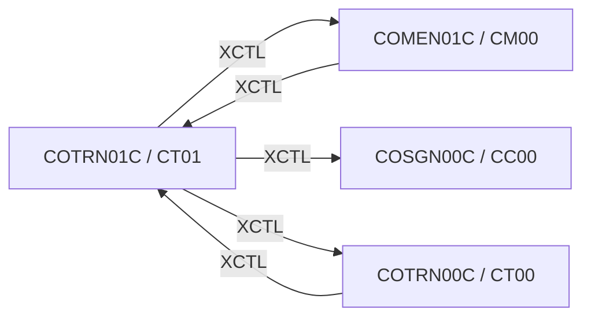

# Tesco | CICS Transaction: `CT01` (Transaction View)

> **Tesco | Mainframe Application Documentation**
> Application: **CardDemo** &nbsp;|&nbsp; Module: **Base application** &nbsp;|&nbsp; Classification: **Tesco Internal**
> Document owner: TODO: owning team &nbsp;|&nbsp; Last reviewed: 2026-11-13

Generated from [`docs/templates/TRANSACTION_DOC_TEMPLATE.md`](../templates/TRANSACTION_DOC_TEMPLATE.md). Back to the [transaction index](README.md).

---

## 1. Transaction ID

| Attribute | Value |
|:--|:--|
| Transaction ID | `CT01` |
| CSD group | `CARDDEMO` |
| CSD definition | `app/csd/CARDDEMO.CSD` |
| CSD description | (none in CSD) |
| Profile / Tran class | `DFHCICST` / `DFHTCL00` |
| Other CSD attributes | `TASKDATALOC(ANY)`, `TASKDATAKEY(USER)`, `ISOLATE(YES)`, `RESSEC(NO)`, `CMDSEC(NO)` |
| README function | Transaction View |

## 2. Program name

| Attribute | Value |
|:--|:--|
| Initial program | `COTRN01C` |
| Source | [`app/cbl/COTRN01C.cbl`](../../app/cbl/COTRN01C.cbl) |
| Program type | CICS COBOL |
| Program header "Function" | View a Transaction from TRANSACT file |

## 3. Mapset / BMS map

| Attribute | Value |
|:--|:--|
| Mapset | `COTRN01` ([`app/bms/COTRN01.bms`](../../app/bms/COTRN01.bms)) |
| Map | `COTRN1A` |
| Symbolic map copybook | [`app/cpy-bms/COTRN01.CPY`](../../app/cpy-bms/COTRN01.CPY) |

## 4. Purpose / Description

Shows all fields of one transaction from `TRANSACT`, looked up by transaction ID (entered, or passed from `CT00`).

## 5. Invocation

| Path | Detail |
|:--|:--|
| Menu path | `CC00` → `CM00` option 7 "Transaction View", or `S` on a row in `CT00`. |
| Direct tranid | Typing the tranid with no COMMAREA (`EIBCALEN = 0`) sends the user back to the sign-on screen (`COSGN00C`). Use the menu path. |
| Pseudo-conversational re-entry | `EXEC CICS RETURN TRANSID(CT01) COMMAREA(...)` |

## 6. Inputs

### 6.1 COMMAREA

Shared CardDemo COMMAREA `CARDDEMO-COMMAREA` ([`app/cpy/COCOM01Y.cpy`](../../app/cpy/COCOM01Y.cpy)). Fields referenced by this program:

| Field | Picture | Usage |
|:--|:--|:--|
| `CDEMO-FROM-PROGRAM` | `X(08)` | Program of the calling screen (PF3 target) |
| `CDEMO-FROM-TRANID` | `X(04)` | Tranid of the calling screen |
| `CDEMO-PGM-CONTEXT` | `9(01)` | `0` first entry / `1` re-entry |
| `CDEMO-TO-PROGRAM` | `X(08)` | Program to XCTL to |

### 6.2 Screen fields (unprotected)

| BMS field | Length | Label (same screen row) |
|:--|:--|:--|
| `TRNIDIN` | 16 | Enter Tran ID |

### 6.3 Function keys

| Key | Action |
|:--|:--|
| ENTER | Look up the transaction |
| PF3 | Back to the calling program / Main Menu |
| PF4 | Clear the screen |
| PF5 | Go to the Transaction List (`CT00`) |

## 7. Outputs

- **Screen:** `TRNID`, `CARDNUM`, `TTYPCD`, `TCATCD`, `TRNSRC`, `TDESC`, `TRNAMT`, `TORIGDT`, `TPROCDT`, `MID`, `MNAME`, `MCITY`, `MZIP`, `ERRMSG` (plus the standard header: `TITLE01`, `TITLE02`, `TRNNAME`, `PGMNAME`, `CURDATE`, `CURTIME`).
- **Messages** (literals found in the program):
  - "Tran ID can NOT be empty..."
  - "Transaction ID NOT found..."
  - "Unable to lookup Transaction..."
- **Records written / messages sent:** None (read-only).

## 8. Data stores accessed

| Type | Resource | Physical name / definition | Record layout | Access |
|:--|:--|:--|:--|:--|
| VSAM | `TRANSACT` | `AWS.M2.CARDDEMO.TRANSACT.VSAM.KSDS` | `CVTRA05Y` (key: Transaction ID) | `READ UPDATE` |

No DB2, IMS, MQ access found in `COTRN01C`.

## 9. Called / linked programs (XCTL / LINK flow)

| Direction | Mechanism | Program (Tranid) | Condition |
|:--|:--|:--|:--|
| Outbound | XCTL | [`COMEN01C`](CM00.md) (`CM00`) | PF3 (exit): back to the Main Menu (or to `CDEMO-FROM-PROGRAM` when it was set by the caller) |
| Outbound | XCTL | [`COSGN00C`](CC00.md) (`CC00`) | No COMMAREA (EIBCALEN = 0) or PF3 on a menu: back to sign-on |
| Outbound | XCTL | [`COTRN00C`](CT00.md) (`CT00`) | PF5: Transaction List (`CT00`) |
| Inbound | XCTL | [`COMEN01C`](CM00.md) (`CM00`) | Menu selection |
| Inbound | XCTL | [`COTRN00C`](CT00.md) (`CT00`) | Row selected with `S`: transaction view (`CT01`) |

## 10. Error handling

| Condition | Detection | Behaviour / message |
|:--|:--|:--|
| NOTFND | `DFHRESP(NOTFND)` | Record not found: message shown, key field highlighted |
| Any other CICS response | `RESP` / `RESP2` not handled above | Generic "unable to ..." message with the response code |
| Invalid key pressed | AID not in the list in 6.3 | Invalid-key message, screen re-sent |

## 11. Security / authorization

| Control | Detail |
|:--|:--|
| Sign-on | User must have signed on through `CC00` (`USRSEC`); identity travels in `CDEMO-USER-ID` / `CDEMO-USER-TYPE`. |
| Role / function | Available to any signed-on user from the Main Menu (menu option flagged `U`). |
| CICS resource security | CSD `RESSEC(NO)`, `CMDSEC(NO)`: no CICS resource or command checks. |
| External security (RACF / ACF2 / Top Secret) | TODO: transaction profile for `CT01` (TCICSTRN / GCICSTRN) owned by the Tesco security team. |

## 12. Change history

| Date | Version / commit | Author | Change |
|:--|:--|:--|:--|
| 2026-11-13 | - | Devin | Initial document generated from template and source inspection. |
| 2022-09-01 | `8c797e2` | Abhijit Kshirsagar | Last repository change to `COTRN01C.cbl`: Release 1.0 |
| - | CSD | AWSUSER | CSD `DEFINETIME(22/06/09 21:37:28)`, `CHANGETIME(22/06/09 21:37:28)` |

## Open items (TODO)

- [ ] TODO: The view reads `TRANSACT` with `READ ... UPDATE` although it never rewrites; confirm whether this lock is intended.
- [ ] TODO: confirm external security (RACF) definitions for `CT01`.
- [ ] TODO: assign a document owner.

---
*Tesco | Internal use only. Generated from `docs/templates/TRANSACTION_DOC_TEMPLATE.md`.*
