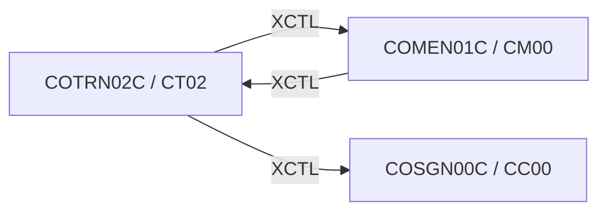

# Tesco | CICS Transaction: `CT02` (Transaction Add)

> **Tesco | Mainframe Application Documentation**
> Application: **CardDemo** &nbsp;|&nbsp; Module: **Base application** &nbsp;|&nbsp; Classification: **Tesco Internal**
> Document owner: TODO: owning team &nbsp;|&nbsp; Last reviewed: 2026-11-13

Generated from [`docs/templates/TRANSACTION_DOC_TEMPLATE.md`](../templates/TRANSACTION_DOC_TEMPLATE.md). Back to the [transaction index](README.md).

---

## 1. Transaction ID

| Attribute | Value |
|:--|:--|
| Transaction ID | `CT02` |
| CSD group | `CARDDEMO` |
| CSD definition | `app/csd/CARDDEMO.CSD` |
| CSD description | (none in CSD) |
| Profile / Tran class | `DFHCICST` / `DFHTCL00` |
| Other CSD attributes | `TASKDATALOC(ANY)`, `TASKDATAKEY(USER)`, `ISOLATE(YES)`, `RESSEC(NO)`, `CMDSEC(NO)` |
| README function | Transaction Add |

## 2. Program name

| Attribute | Value |
|:--|:--|
| Initial program | `COTRN02C` |
| Source | [`app/cbl/COTRN02C.cbl`](../../app/cbl/COTRN02C.cbl) |
| Program type | CICS COBOL |
| Program header "Function" | Add a new Transaction to TRANSACT file |

## 3. Mapset / BMS map

| Attribute | Value |
|:--|:--|
| Mapset | `COTRN02` ([`app/bms/COTRN02.bms`](../../app/bms/COTRN02.bms)) |
| Map | `COTRN2A` |
| Symbolic map copybook | [`app/cpy-bms/COTRN02.CPY`](../../app/cpy-bms/COTRN02.CPY) |

## 4. Purpose / Description

Adds a new card transaction. The user enters an account ID or card number (cross-checked through `CXACAIX` / `CCXREF`) plus type, category, source, description, amount, dates and merchant data. After confirmation (`Y`), the next transaction ID is found by browsing to the highest key on `TRANSACT` (max key + 1) and the record is written.

## 5. Invocation

| Path | Detail |
|:--|:--|
| Menu path | `CC00` → `CM00` option 8 "Transaction Add". |
| Direct tranid | Typing the tranid with no COMMAREA (`EIBCALEN = 0`) sends the user back to the sign-on screen (`COSGN00C`). Use the menu path. |
| Pseudo-conversational re-entry | `EXEC CICS RETURN TRANSID(CT02) COMMAREA(...)` |

## 6. Inputs

### 6.1 COMMAREA

Shared CardDemo COMMAREA `CARDDEMO-COMMAREA` ([`app/cpy/COCOM01Y.cpy`](../../app/cpy/COCOM01Y.cpy)). Fields referenced by this program:

| Field | Picture | Usage |
|:--|:--|:--|
| `CDEMO-FROM-PROGRAM` | `X(08)` | Program of the calling screen (PF3 target) |
| `CDEMO-FROM-TRANID` | `X(04)` | Tranid of the calling screen |
| `CDEMO-PGM-CONTEXT` | `9(01)` | `0` first entry / `1` re-entry |
| `CDEMO-TO-PROGRAM` | `X(08)` | Program to XCTL to |

### 6.2 Screen fields (unprotected)

| BMS field | Length | Label (same screen row) |
|:--|:--|:--|
| `ACTIDIN` | 11 | Enter Acct # |
| `CARDNIN` | 16 | Card # |
| `TTYPCD` | 2 | Type CD |
| `TCATCD` | 4 | Category CD |
| `TRNSRC` | 10 | Source |
| `TDESC` | 60 | Description |
| `TRNAMT` | 12 | Amount |
| `TORIGDT` | 10 | Orig Date |
| `TPROCDT` | 10 | Proc Date |
| `MID` | 9 | Merchant ID |
| `MNAME` | 30 | Merchant Name |
| `MCITY` | 25 | Merchant City |
| `MZIP` | 10 | Merchant Zip |
| `CONFIRM` | 1 | You are about to add this transaction. Please c onfirm |

### 6.3 Function keys

| Key | Action |
|:--|:--|
| ENTER | Validate input; with Confirm = `Y`, add the transaction |
| PF3 | Back to the calling program / Main Menu |
| PF4 | Clear the screen |
| PF5 | Copy data from the last transaction for this card |

## 7. Outputs

- **Screen:** `ERRMSG` (plus the standard header: `TITLE01`, `TITLE02`, `TRNNAME`, `PGMNAME`, `CURDATE`, `CURTIME`).
- **Messages** (literals found in the program):
  - "Confirm to add this transaction..."
  - "Invalid value. Valid values are (Y/N)..."
  - "Account ID must be Numeric..."
  - "Card Number must be Numeric..."
  - "Account or Card Number must be entered..."
  - "Type CD can NOT be empty..."
  - "Category CD can NOT be empty..."
  - "Source can NOT be empty..."
  - "Description can NOT be empty..."
  - "Amount can NOT be empty..."
  - ... 22 more in the source.
- **Records written / messages sent:** `TRANSACT` (WRITE)

## 8. Data stores accessed

| Type | Resource | Physical name / definition | Record layout | Access |
|:--|:--|:--|:--|:--|
| VSAM | `CCXREF` | `AWS.M2.CARDDEMO.CARDXREF.VSAM.KSDS` | `CVACT03Y` (key: Card number) | `READ` |
| VSAM | `CXACAIX` | `AWS.M2.CARDDEMO.CARDXREF.VSAM.AIX.PATH` | `CVACT03Y` (key: Account ID (alternate index path over CCXREF)) | `READ` |
| VSAM | `TRANSACT` | `AWS.M2.CARDDEMO.TRANSACT.VSAM.KSDS` | `CVTRA05Y` (key: Transaction ID) | `ENDBR`, `READPREV`, `STARTBR`, `WRITE` |

No DB2, IMS, MQ access found in `COTRN02C`.

## 9. Called / linked programs (XCTL / LINK flow)

| Direction | Mechanism | Program (Tranid) | Condition |
|:--|:--|:--|:--|
| Outbound | XCTL | [`COMEN01C`](CM00.md) (`CM00`) | PF3 (exit): back to the Main Menu (or to `CDEMO-FROM-PROGRAM` when it was set by the caller) |
| Outbound | XCTL | [`COSGN00C`](CC00.md) (`CC00`) | No COMMAREA (EIBCALEN = 0) or PF3 on a menu: back to sign-on |
| Inbound | XCTL | [`COMEN01C`](CM00.md) (`CM00`) | Menu selection |

## 10. Error handling

| Condition | Detection | Behaviour / message |
|:--|:--|:--|
| DUPKEY | `DFHRESP(DUPKEY)` | Duplicate key on write: "already exists" message |
| DUPREC | `DFHRESP(DUPREC)` | Duplicate record on write: "already exists" message |
| ENDFILE | `DFHRESP(ENDFILE)` | End / start of file while paging: "no more records" message |
| NOTFND | `DFHRESP(NOTFND)` | Record not found: message shown, key field highlighted |
| Any other CICS response | `RESP` / `RESP2` not handled above | Generic "unable to ..." message with the response code |
| Invalid key pressed | AID not in the list in 6.3 | Invalid-key message, screen re-sent |

## 11. Security / authorization

| Control | Detail |
|:--|:--|
| Sign-on | User must have signed on through `CC00` (`USRSEC`); identity travels in `CDEMO-USER-ID` / `CDEMO-USER-TYPE`. |
| Role / function | Available to any signed-on user from the Main Menu (menu option flagged `U`). |
| CICS resource security | CSD `RESSEC(NO)`, `CMDSEC(NO)`: no CICS resource or command checks. |
| External security (RACF / ACF2 / Top Secret) | TODO: transaction profile for `CT02` (TCICSTRN / GCICSTRN) owned by the Tesco security team. |

## 12. Change history

| Date | Version / commit | Author | Change |
|:--|:--|:--|:--|
| 2026-11-13 | - | Devin | Initial document generated from template and source inspection. |
| 2022-09-01 | `8c797e2` | Abhijit Kshirsagar | Last repository change to `COTRN02C.cbl`: Release 1.0 |
| - | CSD | AWSUSER | CSD `DEFINETIME(22/07/13 22:39:44)`, `CHANGETIME(22/07/13 22:39:44)` |

## Open items (TODO)

- [ ] TODO: Max-key + 1 ID generation is not safe under concurrent adds; confirm whether this is acceptable for the target platform.
- [ ] TODO: confirm external security (RACF) definitions for `CT02`.
- [ ] TODO: assign a document owner.

---
*Tesco | Internal use only. Generated from `docs/templates/TRANSACTION_DOC_TEMPLATE.md`.*
