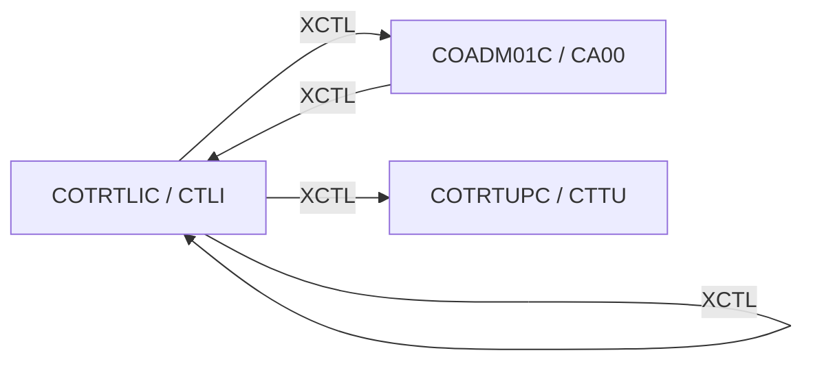

# Tesco | CICS Transaction: `CTLI` (Transaction Type List / Update / Delete)

> **Tesco | Mainframe Application Documentation**
> Application: **CardDemo** &nbsp;|&nbsp; Module: **Db2: Transaction Type Mgmt** &nbsp;|&nbsp; Classification: **Tesco Internal**
> Document owner: TODO: owning team &nbsp;|&nbsp; Last reviewed: 2026-11-13

Generated from [`docs/templates/TRANSACTION_DOC_TEMPLATE.md`](../templates/TRANSACTION_DOC_TEMPLATE.md). Back to the [transaction index](README.md).

---

## 1. Transaction ID

| Attribute | Value |
|:--|:--|
| Transaction ID | `CTLI` |
| CSD group | `CARDDEMO` |
| CSD definition | `app/app-transaction-type-db2/csd/CRDDEMOD.csd` |
| CSD description | (none in CSD) |
| Profile / Tran class | `DFHCICST` / `DFHTCL00` |
| Other CSD attributes | `TASKDATALOC(ANY)`, `TASKDATAKEY(USER)`, `ISOLATE(YES)`, `RESSEC(NO)`, `CMDSEC(NO)` |
| README function | Tran Type list/update/delete (Demonstrates cursor and delete in Db2) |

## 2. Program name

| Attribute | Value |
|:--|:--|
| Initial program | `COTRTLIC` |
| Source | [`app/app-transaction-type-db2/cbl/COTRTLIC.cbl`](../../app/app-transaction-type-db2/cbl/COTRTLIC.cbl) |
| Program type | CICS COBOL + Db2 |
| Program header "Function" | List Transaction Type for updates and deletes |

## 3. Mapset / BMS map

| Attribute | Value |
|:--|:--|
| Mapset | `COTRTLI` ([`app/app-transaction-type-db2/bms/COTRTLI.bms`](../../app/app-transaction-type-db2/bms/COTRTLI.bms)) |
| Map | `CTRTLIA` |
| Symbolic map copybook | [`app/app-transaction-type-db2/cpy-bms/COTRTLI.cpy`](../../app/app-transaction-type-db2/cpy-bms/COTRTLI.cpy) |

## 4. Purpose / Description

Lists Db2 transaction types with a cursor (`FETCH` forward / backward by key), with optional type-code and description filters. Rows can be marked `U` (update the description in place) or `D` (delete); PF10 confirms. PF2 jumps to add a new type in `CTTU`.

## 5. Invocation

| Path | Detail |
|:--|:--|
| Menu path | `CC00` (admin) → `CA00` option 5 "Transaction Type List/Update (Db2)". |
| Direct tranid | With no COMMAREA the program starts a fresh COMMAREA and shows its screen. TODO: confirm the user/role context is set correctly when entered directly instead of through the menu. |
| Pseudo-conversational re-entry | `EXEC CICS RETURN TRANSID(CTLI) COMMAREA(...)` |

## 6. Inputs

### 6.1 COMMAREA

Shared CardDemo COMMAREA `CARDDEMO-COMMAREA` ([`app/cpy/COCOM01Y.cpy`](../../app/cpy/COCOM01Y.cpy)). Fields referenced by this program:

| Field | Picture | Usage |
|:--|:--|:--|
| `CDEMO-FROM-PROGRAM` | `X(08)` | Program of the calling screen (PF3 target) |
| `CDEMO-FROM-TRANID` | `X(04)` | Tranid of the calling screen |
| `CDEMO-LAST-MAP` | `X(7)` | Last map sent |
| `CDEMO-LAST-MAPSET` | `X(7)` | Last mapset sent |
| `CDEMO-TO-PROGRAM` | `X(08)` | Program to XCTL to |
| `CDEMO-TO-TRANID` | `X(04)` | Tranid to transfer to |

The program appends its own working fields after the shared area (paging keys, selection flags). See the program source for the layout.

### 6.2 Screen fields (unprotected)

| BMS field | Length | Label (same screen row) |
|:--|:--|:--|
| `TRTYPE` | 2 | Type Filter |
| `TRDESC` | 50 | Description Filter |
| `TRTYPD1` | 50 |  |
| `TRTYPD2` | 50 |  |
| `TRTYPD3` | 50 |  |
| `TRTYPD4` | 50 |  |
| `TRTYPD5` | 50 |  |
| `TRTYPD6` | 50 |  |
| `TRTYPD7` | 50 |  |

### 6.3 Function keys

| Key | Action |
|:--|:--|
| ENTER | Apply filters / process row selection |
| PF2 | Add a new transaction type (XCTL `COTRTUPC`) |
| PF3 | Back to Admin Menu |
| PF7 | Previous page |
| PF8 | Next page |
| PF10 | Confirm the pending update or delete |

## 7. Outputs

- **Screen:** `PAGENO`, `TRTSEL1`, `TRTTYP1`, `TRTSEL2`, `TRTTYP2`, `TRTSEL3`, `TRTTYP3`, `TRTSEL4`, `TRTTYP4`, `TRTSEL5`, `TRTTYP5`, `TRTSEL6`, `TRTTYP6`, `TRTSEL7`, `TRTTYP7`, `TRTSELA`, `TRTTYPA`, `TRTDSCA`, `INFOMSG`, `ERRMSG`, `BUTNF02`, `BUTNF03`, `BUTNF07`, `BUTNF08`, `BUTNF10` (plus the standard header: `TITLE01`, `TITLE02`, `TRNNAME`, `PGMNAME`, `CURDATE`, `CURTIME`).
- **Messages** (literals found in the program):
  - "TYPE CODE FILTER,IF SUPPLIED MUST BE A 2 DIGIT NUMBER"
  - "No Records found for these filter conditions"
  - "No previous pages to display"
  - "No more pages to display"
  - "Type U to update, D to delete any record"
  - "Delete HIGHLIGHTED row ? Press F10 to confirm"
  - "Update HIGHLIGHTED row. Press F10 to save"
  - "HIGHLIGHTED row deleted.Hit Enter to continue"
  - "HIGHLIGHTED row was updated"
  - "PF03 pressed. Exiting"
  - ... 5 more in the source.
- **Records written / messages sent:** Db2 `CARDDEMO.TRANSACTION_TYPE` rows updated / deleted.

## 8. Data stores accessed

| Type | Resource | Physical name / definition | Record layout | Access |
|:--|:--|:--|:--|:--|
| DB2 | `CARDDEMO.TRANSACTION_TYPE` | `app/app-transaction-type-db2/ddl/TRNTYPE.ddl`, index `XTRNTYPE.ddl` | `app/app-transaction-type-db2/dcl/DCLTRTYP.dcl` | Cursor `DECLARE` / `OPEN` / `FETCH` / `CLOSE`, `SELECT`, `UPDATE`, `DELETE` |

No IMS, MQ access found in `COTRTLIC`.

## 9. Called / linked programs (XCTL / LINK flow)

| Direction | Mechanism | Program (Tranid) | Condition |
|:--|:--|:--|:--|
| Outbound | XCTL | [`COADM01C`](CA00.md) (`CA00`) | PF3 (exit): back to the Admin Menu |
| Outbound | XCTL | [`COTRTLIC`](CTLI.md) (`CTLI`) | Re-entry of the list |
| Outbound | XCTL | [`COTRTUPC`](CTTU.md) (`CTTU`) | PF2: add a transaction type (`CTTU`) |
| Inbound | XCTL | [`COADM01C`](CA00.md) (`CA00`) | Menu selection |

## 10. Error handling

| Condition | Detection | Behaviour / message |
|:--|:--|:--|
| Invalid key pressed | AID not in the list in 6.3 | Invalid-key message, screen re-sent |
| Delete blocked by a dependent row / SQL error | `SQLCODE` after `DELETE` / `UPDATE` | Message shown on the screen; TODO: list exact SQLCODEs handled (e.g. -532 for RI violation) |

## 11. Security / authorization

| Control | Detail |
|:--|:--|
| Sign-on | User must have signed on through `CC00` (`USRSEC`); identity travels in `CDEMO-USER-ID` / `CDEMO-USER-TYPE`. |
| Role / function | Admin-only (reached from `CA00`). CSD DB2ENTRY / DB2TRAN plan authorisation applies. TODO: confirm plan / package owner and GRANTs. |
| CICS resource security | CSD `RESSEC(NO)`, `CMDSEC(NO)`: no CICS resource or command checks. |
| External security (RACF / ACF2 / Top Secret) | TODO: transaction profile for `CTLI` (TCICSTRN / GCICSTRN) owned by the Tesco security team. |

## 12. Change history

| Date | Version / commit | Author | Change |
|:--|:--|:--|:--|
| 2026-11-13 | - | Devin | Initial document generated from template and source inspection. |
| 2025-08-03 | `fb78417` | Arunkumar Selvam | Last repository change to `COTRTLIC.cbl`: Add optional modules and enhanced functionality |
| - | CSD | AWSUSER | CSD `DEFINETIME(23/03/13 15:32:24)`, `CHANGETIME(23/03/13 15:32:51)` |

## Open items (TODO)

- [ ] TODO: `CARDDEMO.TRANSACTION_TYPE_CATEGORY` (`TRNTYCAT.ddl`) exists in the module but is not referenced by `COTRTLIC`; confirm whether it is in scope.
- [ ] TODO: confirm external security (RACF) definitions for `CTLI`.
- [ ] TODO: assign a document owner.

---
*Tesco | Internal use only. Generated from `docs/templates/TRANSACTION_DOC_TEMPLATE.md`.*
