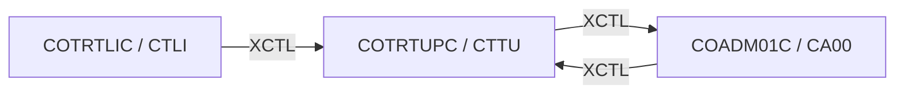

# Tesco | CICS Transaction: `CTTU` (Transaction Type Add / Edit)

> **Tesco | Mainframe Application Documentation**
> Application: **CardDemo** &nbsp;|&nbsp; Module: **Db2: Transaction Type Mgmt** &nbsp;|&nbsp; Classification: **Tesco Internal**
> Document owner: TODO: owning team &nbsp;|&nbsp; Last reviewed: 2026-11-13

Generated from [`docs/templates/TRANSACTION_DOC_TEMPLATE.md`](../templates/TRANSACTION_DOC_TEMPLATE.md). Back to the [transaction index](README.md).

---

## 1. Transaction ID

| Attribute | Value |
|:--|:--|
| Transaction ID | `CTTU` |
| CSD group | `CARDDEMO` |
| CSD definition | `app/app-transaction-type-db2/csd/CRDDEMOD.csd` |
| CSD description | (none in CSD) |
| Profile / Tran class | `DFHCICST` / `DFHTCL00` |
| Other CSD attributes | `TASKDATALOC(ANY)`, `TASKDATAKEY(USER)`, `ISOLATE(YES)`, `RESSEC(NO)`, `CMDSEC(NO)` |
| README function | Tran Type add/edit (Update and insert on Db2) |

## 2. Program name

| Attribute | Value |
|:--|:--|
| Initial program | `COTRTUPC` |
| Source | [`app/app-transaction-type-db2/cbl/COTRTUPC.cbl`](../../app/app-transaction-type-db2/cbl/COTRTUPC.cbl) |
| Program type | CICS COBOL + Db2 |
| Program header "Function" | Accept and process TRANSACTION TYPE UPDATE |

## 3. Mapset / BMS map

| Attribute | Value |
|:--|:--|
| Mapset | `COTRTUP` ([`app/app-transaction-type-db2/bms/COTRTUP.bms`](../../app/app-transaction-type-db2/bms/COTRTUP.bms)) |
| Map | `CTRTUPA` |
| Symbolic map copybook | [`app/app-transaction-type-db2/cpy-bms/COTRTUP.cpy`](../../app/app-transaction-type-db2/cpy-bms/COTRTUP.cpy) |

## 4. Purpose / Description

Maintains one row of Db2 table `CARDDEMO.TRANSACTION_TYPE` (2-character type code and description). The code is looked up; if found it can be changed or deleted, if not found the user can add it. Changes are validated and confirmed before the SQL `UPDATE`, `INSERT` or `DELETE`.

## 5. Invocation

| Path | Detail |
|:--|:--|
| Menu path | `CC00` (admin) → `CA00` option 6 "Transaction Type Maintenance (Db2)". |
| Direct tranid | With no COMMAREA the program starts a fresh COMMAREA and shows its screen. TODO: confirm the user/role context is set correctly when entered directly instead of through the menu. |
| Pseudo-conversational re-entry | `EXEC CICS RETURN TRANSID(CTTU) COMMAREA(...)` |

## 6. Inputs

### 6.1 COMMAREA

Shared CardDemo COMMAREA `CARDDEMO-COMMAREA` ([`app/cpy/COCOM01Y.cpy`](../../app/cpy/COCOM01Y.cpy)). Fields referenced by this program:

| Field | Picture | Usage |
|:--|:--|:--|
| `CDEMO-ACCT-ID` | `9(11)` | Account in context |
| `CDEMO-ACCT-STATUS` | `X(01)` | Account status |
| `CDEMO-CARD-NUM` | `9(16)` | Card in context |
| `CDEMO-FROM-PROGRAM` | `X(08)` | Program of the calling screen (PF3 target) |
| `CDEMO-FROM-TRANID` | `X(04)` | Tranid of the calling screen |
| `CDEMO-LAST-MAP` | `X(7)` | Last map sent |
| `CDEMO-LAST-MAPSET` | `X(7)` | Last mapset sent |
| `CDEMO-TO-PROGRAM` | `X(08)` | Program to XCTL to |
| `CDEMO-TO-TRANID` | `X(04)` | Tranid to transfer to |

The program appends its own working fields after the shared area (paging keys, selection flags). See the program source for the layout.

### 6.2 Screen fields (unprotected)

| BMS field | Length | Label (same screen row) |
|:--|:--|:--|
| `TRTYPCD` | 2 | Transaction Type |
| `TRTYDSC` | 50 | Description |

### 6.3 Function keys

| Key | Action |
|:--|:--|
| ENTER | Fetch the type code / validate changes |
| PF3 | Back to Admin Menu |
| PF4 | Request delete of the displayed type, then confirm the delete |
| PF5 | Request save (add or update), then confirm the save |
| PF12 | Cancel the pending change |

## 7. Outputs

- **Screen:** `INFOMSG`, `ERRMSG`, `FKEYS`, `FKEY04`, `FKEY05`, `FKEY06`, `FKEY12` (plus the standard header: `TITLE01`, `TITLE02`, `TRNNAME`, `PGMNAME`, `CURDATE`, `CURTIME`).
- **Messages** (literals found in the program):
  - "Selected transaction type shown above"
  - "Enter transaction type to be maintained"
  - "Press F05 to add. F12 to cancel"
  - "Delete this record ? Press F4 to confirm"
  - "Delete successful."
  - "Update transaction type details shown."
  - "Enter new transaction type details."
  - "Changes validated.Press F5 to save"
  - "Changes committed to database"
  - "Changes unsuccessful"
  - ... 14 more in the source.
- **Records written / messages sent:** Db2 `CARDDEMO.TRANSACTION_TYPE` row inserted / updated / deleted.

## 8. Data stores accessed

| Type | Resource | Physical name / definition | Record layout | Access |
|:--|:--|:--|:--|:--|
| DB2 | `CARDDEMO.TRANSACTION_TYPE` | `app/app-transaction-type-db2/ddl/TRNTYPE.ddl`, index `XTRNTYPE.ddl` | `app/app-transaction-type-db2/dcl/DCLTRTYP.dcl` | `SELECT`, `INSERT`, `UPDATE`, `DELETE` |

No IMS, MQ access found in `COTRTUPC`.

## 9. Called / linked programs (XCTL / LINK flow)

| Direction | Mechanism | Program (Tranid) | Condition |
|:--|:--|:--|:--|
| Outbound | XCTL | [`COADM01C`](CA00.md) (`CA00`) | PF3 (exit): back to the Admin Menu |
| Inbound | XCTL | [`COADM01C`](CA00.md) (`CA00`) | Menu selection |
| Inbound | XCTL | [`COTRTLIC`](CTLI.md) (`CTLI`) | PF2: add a transaction type (`CTTU`) |

## 10. Error handling

| Condition | Detection | Behaviour / message |
|:--|:--|:--|
| Unexpected abend | `EXEC CICS HANDLE ABEND LABEL(ABEND-ROUTINE)` | Abend details sent to the terminal; then `EXEC CICS ABEND ABCODE(0001, 9999)` |
| Invalid key pressed | AID not in the list in 6.3 | Invalid-key message, screen re-sent |
| Row not found / duplicate / SQL error | `SQLCODE` checks after each statement | Message shown on the screen; TODO: list the exact SQLCODE handling (e.g. +100, -803, -532) |

## 11. Security / authorization

| Control | Detail |
|:--|:--|
| Sign-on | User must have signed on through `CC00` (`USRSEC`); identity travels in `CDEMO-USER-ID` / `CDEMO-USER-TYPE`. |
| Role / function | Admin-only (reached from `CA00`). CSD DB2ENTRY / DB2TRAN plan authorisation applies. TODO: confirm plan / package owner and GRANTs. |
| CICS resource security | CSD `RESSEC(NO)`, `CMDSEC(NO)`: no CICS resource or command checks. |
| External security (RACF / ACF2 / Top Secret) | TODO: transaction profile for `CTTU` (TCICSTRN / GCICSTRN) owned by the Tesco security team. |

## 12. Change history

| Date | Version / commit | Author | Change |
|:--|:--|:--|:--|
| 2026-11-13 | - | Devin | Initial document generated from template and source inspection. |
| 2025-08-03 | `fb78417` | Arunkumar Selvam | Last repository change to `COTRTUPC.cbl`: Add optional modules and enhanced functionality |
| - | CSD | AWSUSER | CSD `DEFINETIME(23/03/09 17:34:06)`, `CHANGETIME(23/03/09 17:34:39)` |

## Open items (TODO)

- [ ] TODO: confirm external security (RACF) definitions for `CTTU`.
- [ ] TODO: assign a document owner.

---
*Tesco | Internal use only. Generated from `docs/templates/TRANSACTION_DOC_TEMPLATE.md`.*
